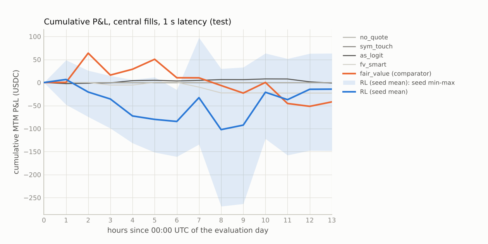
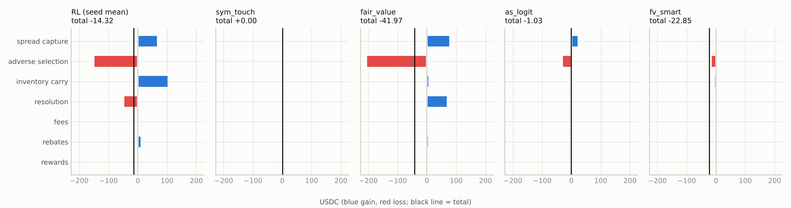
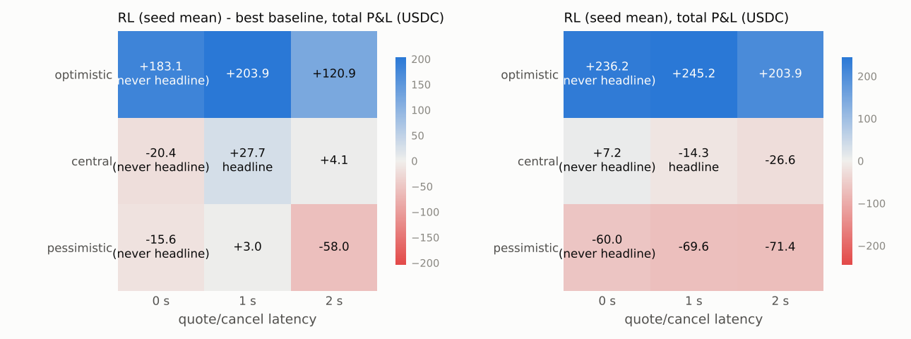

# Polymarket market making: Final test results

Generated 2026-10-15T14:40:14+00:00 by `final/report.py` from `results/test`; plan sha256 `75915990669c7038e81649a4e609ec8c776b0f264f0497fe390113e639eb4b6d`; run `test-2026-10-15T134716+0000`; 127 markets; bootstrap stationary, 10000 replicates, block length Politis-White floored at 2 h.

## 1. Primary endpoint and decision rule

test-day total P&L of the selected RL config (seed mean) minus the best tuned baseline, central fills, 1 s latency, rewards+rebates included. Comparator (fixed in the plan): **fair_value** (highest val P&L (central fills, 1 s) in tuned.json among the tuned baselines and no-quote (DECISIONS.md D1.1)).

Protocol amendments applied (eval/DECISIONS.md, sha256 `00fcb6def870ef70`): D1 comparators (no-quote a candidate; constrained secondary baselines; market-making classification); D2 T5 rule on artifact flags only.

| statistic | estimate | 95% CI | block length (h) | hours | corr(RL, baseline) |
| :--- | ---: | ---: | ---: | ---: | ---: |
| RL seed mean - best baseline, total P&L | +27.65 | [-259.07, +293.92] | 2.0 | 13 | 0.13 |

| criterion (all required) | verdict | detail |
| :--- | :--- | :--- |
| primary endpoint 95% CI lower bound > 0 | FAIL | CI lower bound -259.07 |
| point estimate > 0 under pessimistic fills at 1 s | PASS | point estimate +2.97 |
| point estimate > 0 under central fills at 2 s | PASS | point estimate +4.06 |
| RL (seed mean) not classified directional (T6) | PASS | inventory share of total n/a, of positive components 40% |
| no invalidating exploit flag (T5), seed-pooled fills | PASS | worst artifact flag None n/a of the fill edge; edge excl. flagged -385.86 (D2 flags) |
| RL counts as making markets: >= 5 fills per market, T6 share <= 50%, T5 artifact share <= 25% (D1.3) | PASS | makes markets: 20.9 fills/market, two-sided uptime 18% (D1.3) |
| RL seed-mean P&L excluding the top 5 markets and excluding the top 3 hours both > 0 (T7) | FAIL | ex-top-5 markets -194.16, ex-top-3 hours -159.86 |

**Overall: FAIL** (the decision rule of EVALUATION.md section 4).

## 2. Headline: central fills, 1 s latency, size x1

| method | P&L total | P&L/day | mean/market | median/market | P&L ex rewards+rebates | hourly Sharpe [95% CI] | CVaR95/market | fills | fills per quoted min | share of taker vol | uptime 2-sided | uptime 1-sided | max |inv| | max portfolio delta $ |
| :--- | ---: | ---: | ---: | ---: | ---: | ---: | ---: | ---: | ---: | ---: | ---: | ---: | ---: | ---: |
| no_quote | +0.00 | +0.00 | +0.000 | +0.000 | +0.00 | n/a | +0.000 | 0 | n/a | 0.00% | 0.0% | 0.0% | 0.0 | 0 |
| sym_touch | +0.00 | +0.00 | +0.000 | +0.000 | +0.00 | n/a | +0.000 | 0 | n/a | 0.00% | 0.0% | 0.0% | 0.0 | 0 |
| fair_value | -41.97 | -41.97 | -0.331 | +0.000 | -48.72 | -0.10 [-0.54, +0.23] | -27.710 | 594 | 0.40 | 0.32% | 10.3% | 8.7% | 100.0 | 259,343 |
| as_logit | -1.03 | -1.03 | -0.008 | +0.000 | -2.92 | -0.03 [-0.62, +0.76] | -2.416 | 751 | 0.21 | 0.20% | 75.7% | 9.9% | 25.0 | 3,942 |
| fv_smart | -22.85 | -22.85 | -0.180 | +0.000 | -23.20 | -0.36 [-0.80, +0.23] | -4.514 | 57 | 1.00 | 0.03% | 0.0% | 0.5% | 75.0 | 40,347 |
| sym_touch (active) | -202.03 | -202.03 | -1.591 | -0.731 | -224.18 | -1.87 [-3.17, -1.37] | -9.110 | 5,627 | 1.42 | 1.26% | 38.6% | 60.0% | 18.9 | 34,801 |
| fair_value (active) | -126.73 | -126.73 | -0.998 | -0.020 | -136.88 | -0.65 [-1.41, -0.18] | -13.393 | 2,694 | 1.20 | 0.56% | 31.8% | 6.9% | 40.0 | 71,899 |
| as_logit (active) | +2.10 | +2.10 | +0.017 | -0.022 | -0.66 | +0.02 [-0.83, +0.49] | -4.468 | 1,921 | 0.78 | 0.34% | 34.0% | 18.8% | 26.6 | 57,948 |
| fv_smart (active) | -265.29 | -265.29 | -2.089 | +0.000 | -297.75 | -0.37 [-1.00, +0.16] | -54.307 | 7,038 | 2.09 | 1.91% | 24.2% | 58.2% | 100.0 | 268,271 |
| **RL (seed mean)** | -14.32 | -14.32 | -0.113 | +0.000 | -27.25 | -0.03 [-0.70, +0.41] | -32.225 | 2,649 | 0.86 | 0.74% | 17.8% | 44.6% | 100.0 | 244,213 |

Sharpe is per hour (not annualised) on the zero-filled hourly MTM grid summed over all markets. CVaR95 is the mean of the worst 5% of per-market P&L. Uptime is over live seconds. For the RL rows every number is the seed mean (max |inv| and portfolio delta: mean over seeds of the max).

## 3. Paired differences vs every baseline (hourly blocks, identical markets)

| method | minus | diff (with rewards+rebates) | 95% CI | diff (floor: without) | 95% CI | corr |
| :--- | ---: | ---: | ---: | ---: | ---: | ---: |
| RL (seed mean) | no_quote | -14.32 | [-207.81, +192.02] | -27.25 | [-222.04, +180.34] | n/a |
| RL (seed mean) | sym_touch | -14.32 | [-207.81, +192.02] | -27.25 | [-222.04, +180.34] | n/a |
| RL (seed mean) | fair_value (comparator) | +27.65 | [-259.07, +293.92] | +21.47 | [-266.01, +287.87] | 0.13 |
| RL (seed mean) | as_logit | -13.29 | [-219.47, +203.49] | -24.33 | [-234.35, +193.74] | -0.27 |
| RL (seed mean) | fv_smart | +8.53 | [-186.82, +213.85] | -4.05 | [-199.12, +199.94] | 0.17 |
| RL (seed mean) | sym_touch (active) (secondary, D1.2) | +187.71 | [-34.25, +425.22] | +196.93 | [-25.37, +434.54] | -0.13 |
| RL (seed mean) | fair_value (active) (secondary, D1.2) | +112.41 | [-144.94, +373.97] | +109.63 | [-148.37, +372.02] | -0.11 |
| RL (seed mean) | as_logit (active) (secondary, D1.2) | -16.42 | [-242.89, +214.93] | -26.59 | [-253.89, +205.06] | -0.09 |
| RL (seed mean) | fv_smart (active) (secondary, D1.2) | +250.97 | [-226.37, +724.76] | +270.50 | [-207.03, +745.30] | -0.14 |

Post hoc (secondary, conservative): the best tuned baseline on this split is **sym_touch** (+0.00); the pre-registered comparator is fair_value.

## 4. Attribution (T6) and markouts

| method | spread capture | adverse selection | inventory carry | resolution | fees | rebates | rewards | total | identity err | vs cash |
| :--- | ---: | ---: | ---: | ---: | ---: | ---: | ---: | ---: | ---: | ---: |
| RL (seed mean) | +68.57 | -150.89 | +104.28 | -49.22 | +0.00 | +12.93 | +0.00 | -14.32 | 2.5e-14 | 3.0e-14 |
| no_quote | +0.00 | +0.00 | +0.00 | +0.00 | +0.00 | +0.00 | +0.00 | +0.00 | 0.0e+00 | 0.0e+00 |
| sym_touch | +0.00 | +0.00 | +0.00 | +0.00 | +0.00 | +0.00 | +0.00 | +0.00 | 0.0e+00 | 0.0e+00 |
| fair_value | +78.67 | -206.21 | +7.43 | +71.40 | +0.00 | +6.74 | +0.00 | -41.97 | 1.4e-14 | 2.1e-14 |
| as_logit | +24.20 | -32.63 | +5.61 | -0.10 | +0.00 | +1.89 | +0.00 | -1.03 | 8.9e-15 | 7.1e-15 |
| fv_smart | +0.14 | -16.85 | -6.48 | -0.01 | +0.00 | +0.35 | +0.00 | -22.85 | 5.3e-15 | 5.3e-15 |
| sym_touch (active) | +67.58 | -302.62 | +20.12 | -9.25 | +0.00 | +22.15 | +0.00 | -202.03 | 1.1e-14 | 8.9e-15 |
| fair_value (active) | +47.39 | -144.45 | -54.55 | +14.73 | +0.00 | +10.15 | +0.00 | -126.73 | 7.1e-15 | 4.4e-15 |
| as_logit (active) | +86.71 | -120.16 | +47.14 | -14.34 | +0.00 | +2.76 | +0.00 | +2.10 | 6.2e-15 | 8.0e-15 |
| fv_smart (active) | +67.74 | -278.73 | -32.07 | -54.69 | +0.00 | +32.46 | +0.00 | -265.29 | 3.6e-14 | 2.8e-14 |

spread capture = sq (mid at fill - price); adverse selection = sq (mid +60 s - mid at fill); inventory carry = sq (mid at 10 s before close - mid +60 s); resolution = sq (settlement - that mid); fees < 0; rebates and liquidity rewards. Components sum to the total; 'identity err' is stats.attribute_pnl's check and 'vs cash' the max per-market difference from the env's own cash accounting.

Markouts (sum of sq x (mid at +h - mid at fill), USDC):

| method | +1 s | +5 s | +10 s | +30 s | +60 s |
| :--- | ---: | ---: | ---: | ---: | ---: |
| RL (seed mean) | -85.42 | -167.27 | -177.98 | -143.41 | -150.89 |
| no_quote | +0.00 | +0.00 | +0.00 | +0.00 | +0.00 |
| sym_touch | +0.00 | +0.00 | +0.00 | +0.00 | +0.00 |
| fair_value | -72.59 | -139.80 | -141.77 | -160.62 | -206.21 |
| as_logit | -14.07 | -35.93 | -38.58 | -33.24 | -32.63 |
| fv_smart | +0.09 | -3.82 | -3.85 | -4.02 | -16.85 |
| sym_touch (active) | -127.01 | -276.46 | -269.49 | -273.99 | -302.62 |
| fair_value (active) | -59.70 | -130.27 | -124.05 | -124.51 | -144.45 |
| as_logit (active) | -42.93 | -90.30 | -96.75 | -126.42 | -120.16 |
| fv_smart (active) | -169.23 | -332.92 | -324.16 | -235.77 | -278.73 |

## 5. Exploit detectors (T5, DECISIONS.md D2) and market-making status (D1.3)

| method | inspread | crossed_or_stale | onesided | last30 | fill edge | excl. flagged | verdict |
| :--- | ---: | ---: | ---: | ---: | ---: | ---: | ---: |
| RL (seed mean) | n/a (607) | n/a (69) | n/a (95) | n/a (142) | -411.57 | -385.86 | valid |
| no_quote | n/a (0) | n/a (0) | n/a (0) | n/a (0) | +0.00 | +0.00 | valid |
| sym_touch | n/a (0) | n/a (0) | n/a (0) | n/a (0) | +0.00 | +0.00 | valid |
| fair_value | n/a (11) | n/a (0) | n/a (7) | n/a (0) | -127.54 | -139.90 | valid |
| as_logit | n/a (42) | n/a (28) | n/a (18) | n/a (3) | -8.43 | -10.98 | valid |
| fv_smart | n/a (4) | n/a (0) | n/a (3) | n/a (0) | -16.71 | -14.11 | valid |
| sym_touch (active) | n/a (234) | n/a (44) | n/a (50) | n/a (57) | -235.04 | -213.55 | valid |
| fair_value (active) | n/a (118) | n/a (9) | n/a (17) | n/a (0) | -97.06 | -100.47 | valid |
| as_logit (active) | n/a (92) | n/a (8) | n/a (62) | n/a (80) | -33.46 | -36.87 | valid |
| fv_smart (active) | n/a (484) | n/a (60) | n/a (54) | n/a (25) | -210.99 | -209.70 | valid |

Artifact flags of D2 (the T5 rule): share of the total fill edge (per fill: spread capture + 60 s markout, the env's pnl_X) from fills under the flag (number of fills); n/a when the total edge is <= 0. Invalid if one of them carries > 25%, or the edge excluding all of them is <= 0 while the total is > 0. RL rows pool the seeds' fills.

Every flag, edge share / volume share (the through-the-touch `outside` flag is reported, not a detector, D2):

| method | crossed | stale | onesided | last30 | last10 | inside2 | extreme | outside | inspread | crossed_or_stale |
| :--- | ---: | ---: | ---: | ---: | ---: | ---: | ---: | ---: | ---: | ---: |
| RL (seed mean) | n/a / 0% | n/a / 0% | n/a / 2% | n/a / 3% | n/a / 1% | n/a / 8% | n/a / 8% | n/a / 66% | n/a / 6% | n/a / 0% |
| no_quote | n/a / n/a | n/a / n/a | n/a / n/a | n/a / n/a | n/a / n/a | n/a / n/a | n/a / n/a | n/a / n/a | n/a / n/a | n/a / n/a |
| sym_touch | n/a / n/a | n/a / n/a | n/a / n/a | n/a / n/a | n/a / n/a | n/a / n/a | n/a / n/a | n/a / n/a | n/a / n/a | n/a / n/a |
| fair_value | n/a / 0% | n/a / 0% | n/a / 1% | n/a / 0% | n/a / 0% | n/a / 4% | n/a / 0% | n/a / 91% | n/a / 2% | n/a / 0% |
| as_logit | n/a / 0% | n/a / 4% | n/a / 3% | n/a / 1% | n/a / 0% | n/a / 7% | n/a / 19% | n/a / 49% | n/a / 9% | n/a / 4% |
| fv_smart | n/a / 0% | n/a / 0% | n/a / 0% | n/a / 0% | n/a / 0% | n/a / 11% | n/a / 0% | n/a / 65% | n/a / 10% | n/a / 0% |
| sym_touch (active) | n/a / 0% | n/a / 1% | n/a / 2% | n/a / 2% | n/a / 0% | n/a / 9% | n/a / 7% | n/a / 65% | n/a / 5% | n/a / 1% |
| fair_value (active) | n/a / 0% | n/a / 0% | n/a / 1% | n/a / 0% | n/a / 0% | n/a / 7% | n/a / 3% | n/a / 71% | n/a / 6% | n/a / 0% |
| as_logit (active) | n/a / 0% | n/a / 1% | n/a / 4% | n/a / 9% | n/a / 2% | n/a / 9% | n/a / 21% | n/a / 62% | n/a / 8% | n/a / 1% |
| fv_smart (active) | n/a / 0% | n/a / 1% | n/a / 1% | n/a / 1% | n/a / 0% | n/a / 8% | n/a / 9% | n/a / 55% | n/a / 9% | n/a / 1% |

Flags (judged on the book at the match second, as the env does): `crossed` book crossed in the raw data (last uncrossed book forward-filled); `stale` book_age > 10 s; `onesided` either side of the book empty; `last30` fewer than 30 s to the close (end - tau < 30); `last10` fewer than 10 s to the close; `inside2` our quote more than 2 ticks inside the touch; `extreme` our quote <= 0.02 or >= 0.98; `outside` the print is outside [best bid, best ask] (includes every sweep through the touch; reported, not an exploit detector: DECISIONS.md D2); `inspread` the print is on the wrong side of the hit touch (a sell above the best bid or a buy below the best ask): the snapshot cannot explain it; `crossed_or_stale` crossed or stale book (union).

D1.3: a policy counts as making markets only with >= 5 fills per market, T6 directional share <= 50% and T5 artifact share <= 25%; otherwise this table says what it does instead.

| method | makes markets | what it does | fills/market | uptime 2-sided | uptime any | markets without fills | failed |
| :--- | ---: | ---: | ---: | ---: | ---: | ---: | ---: |
| RL (seed mean) | yes | makes markets | 20.9 | 18% | 62% | 16% | - |
| no_quote | **no** | mostly does not quote | 0.0 | 0% | 0% | 100% | fills |
| sym_touch | **no** | mostly does not quote | 0.0 | 0% | 0% | 100% | fills |
| fair_value | **no** | quotes mostly one side | 4.7 | 10% | 19% | 51% | fills |
| as_logit | yes | makes markets | 5.9 | 76% | 86% | 45% | - |
| fv_smart | **no** | mostly does not quote | 0.4 | 0% | 1% | 93% | fills |
| sym_touch (active) | yes | makes markets | 44.3 | 39% | 99% | 16% | - |
| fair_value (active) | yes | makes markets | 21.2 | 32% | 39% | 20% | - |
| as_logit (active) | **no** | holds directional inventory (T6) | 15.1 | 34% | 53% | 15% | t6 |
| fv_smart (active) | yes | makes markets | 55.4 | 24% | 82% | 15% | - |

Fills by time to close (all methods, headline; a policy that only trades in the last seconds is suspect):

| method | <=10 s | 10-30 s | 30-60 s | 1-5 min | 5-15 min | >15 min |
| :--- | ---: | ---: | ---: | ---: | ---: | ---: |
| RL (seed mean) | 0.2% | 1.0% | 4.4% | 67.0% | 21.5% | 5.9% |
| no_quote | 0.0% | 0.0% | 0.0% | 0.0% | 0.0% | 0.0% |
| sym_touch | 0.0% | 0.0% | 0.0% | 0.0% | 0.0% | 0.0% |
| fair_value | 0.0% | 0.0% | 0.0% | 71.0% | 28.5% | 0.5% |
| as_logit | 0.0% | 0.5% | 0.5% | 36.1% | 39.8% | 23.0% |
| fv_smart | 0.0% | 0.0% | 0.0% | 100.0% | 0.0% | 0.0% |
| sym_touch (active) | 0.2% | 1.0% | 3.5% | 62.6% | 25.1% | 7.6% |
| fair_value (active) | 0.0% | 0.0% | 0.0% | 65.5% | 29.0% | 5.5% |
| as_logit (active) | 0.7% | 4.2% | 12.8% | 75.6% | 4.6% | 2.1% |
| fv_smart (active) | 0.0% | 0.5% | 4.5% | 65.8% | 22.9% | 6.3% |

## 6. Directional gambling (T6) and the mirror test

| method | inventory P&L | share of total | share of positive | class | P&L Up-won mkts | P&L Down-won mkts | corr(inv, next 60 s return) | mirror - original [95% CI] |
| :--- | ---: | ---: | ---: | ---: | ---: | ---: | ---: | ---: |
| RL (seed mean) | +55.07 | n/a | 40% | market making | +333.80 | -348.12 | +0.013 | -28.21 [-658.55, +591.48] unchanged |
| no_quote | +0.00 | n/a | n/a | market making | +0.00 | +0.00 | n/a | +0.00 [+0.00, +0.00] unchanged |
| sym_touch | +0.00 | n/a | n/a | market making | +0.00 | +0.00 | n/a | +0.00 [+0.00, +0.00] unchanged |
| fair_value | +78.83 | n/a | 48% | market making | -91.93 | +49.96 | +0.005 | +0.00 [-0.00, +0.00] unchanged |
| as_logit | +5.51 | n/a | 17% | market making | -1.84 | +0.81 | +0.017 | +0.00 [-0.00, +0.00] unchanged |
| fv_smart | -6.49 | n/a | -1316% | market making | -10.28 | -12.56 | +0.003 | +0.00 [-0.00, +0.00] unchanged |
| sym_touch (active) | +10.87 | n/a | 11% | market making | -87.23 | -114.80 | +0.002 | -0.00 [-0.00, +0.00] unchanged |
| fair_value (active) | -39.82 | n/a | -69% | market making | -91.32 | -35.41 | -0.008 | -0.00 [-0.00, +0.00] unchanged |
| as_logit (active) | +32.80 | 1560% | 27% | **DIRECTIONAL** | +21.78 | -19.68 | +0.015 | -0.00 [-0.00, +0.00] unchanged |
| fv_smart (active) | -86.76 | n/a | -87% | market making | -227.64 | -37.66 | +0.009 | +0.00 [-0.00, +0.00] unchanged |

## 7. Concentration (T7)

| method | total | top-1 mkt | top-5 mkts | top-10 mkts | ex top-5 mkts | eff. # mkts | # mkts for half profit | mkts > 0 | top-1 hour | ex top-3 hours | hours > 0 |
| :--- | ---: | ---: | ---: | ---: | ---: | ---: | ---: | ---: | ---: | ---: | ---: |
| RL (seed mean) | -14.32 | n/a | n/a | n/a | -194.16 | 32.8 | 6 | 39% | n/a | -159.86 | 46% |
| no_quote | +0.00 | n/a | n/a | n/a | +0.00 | n/a | 0 | 0% | n/a | +0.00 | 0% |
| sym_touch | +0.00 | n/a | n/a | n/a | +0.00 | n/a | 0 | 0% | n/a | +0.00 | 0% |
| fair_value | -41.97 | n/a | n/a | n/a | -203.42 | 17.0 | 3 | 20% | n/a | -150.14 | 46% |
| as_logit | -1.03 | n/a | n/a | n/a | -16.09 | 11.7 | 2 | 20% | n/a | -9.08 | 54% |
| fv_smart | -22.85 | n/a | n/a | n/a | -28.67 | 4.0 | 1 | 2% | n/a | -28.66 | 8% |
| sym_touch (active) | -202.03 | n/a | n/a | n/a | -219.68 | 52.5 | 4 | 16% | n/a | -190.53 | 0% |
| fair_value (active) | -126.73 | n/a | n/a | n/a | -172.56 | 32.1 | 4 | 28% | n/a | -152.62 | 31% |
| as_logit (active) | +2.10 | 1276% | 2172% | 2488% | -43.57 | 13.3 | 2 | 28% | 1058% | -31.98 | 38% |
| fv_smart (active) | -265.29 | n/a | n/a | n/a | -469.37 | 42.9 | 8 | 36% | n/a | -386.52 | 46% |

## 8. Fill model x latency grid, size sweep

| method | optimistic 0 s | optimistic 1 s | optimistic 2 s | central 0 s | central 1 s | central 2 s | pessimistic 0 s | pessimistic 1 s | pessimistic 2 s |
| :--- | ---: | ---: | ---: | ---: | ---: | ---: | ---: | ---: | ---: |
| no_quote | +0.00 | +0.00 | +0.00 | +0.00 | +0.00 | +0.00 | +0.00 | +0.00 | +0.00 |
| sym_touch | +0.00 | +0.00 | +0.00 | +0.00 | +0.00 | +0.00 | +0.00 | +0.00 | +0.00 |
| fair_value | +53.10 | +41.34 | +82.97 | +27.55 | -41.97 | -30.71 | -44.39 | -72.59 | -13.34 |
| as_logit | +20.39 | +11.68 | +11.06 | -6.84 | -1.03 | +2.58 | +2.29 | +2.45 | -2.19 |
| fv_smart | -29.61 | -25.79 | -30.23 | -23.83 | -22.85 | -26.10 | -10.49 | -6.50 | -7.21 |
| sym_touch (active) | +106.55 | +133.96 | +142.58 | -190.29 | -202.03 | -190.29 | -133.93 | -140.41 | -134.98 |
| fair_value (active) | +86.60 | +70.30 | +33.59 | -69.83 | -126.73 | -108.68 | -39.39 | -66.29 | -100.97 |
| as_logit (active) | +67.92 | +71.06 | +73.15 | +8.86 | +2.10 | +5.56 | -4.92 | -5.49 | -26.93 |
| fv_smart (active) | +343.76 | +365.47 | +478.79 | -90.74 | -265.29 | -307.92 | -169.76 | -156.58 | -234.68 |
| RL (seed mean) | +236.21 | +245.21 | +203.85 | +7.15 | -14.32 | -26.65 | -60.03 | -69.62 | -71.37 |

RL (seed mean) minus fair_value per cell:

| variant | diff | 95% CI |  |
| :--- | ---: | ---: | ---: |
| optimistic_lat0 | +183.11 | [+5.15, +359.32] | never headline |
| optimistic_lat1 | +203.87 | [-51.54, +463.21] |  |
| optimistic_lat2 | +120.88 | [-187.93, +413.55] |  |
| central_lat0 | -20.39 | [-278.21, +231.58] | never headline |
| central_lat1 | +27.65 | [-259.07, +293.92] | headline |
| central_lat2 | +4.06 | [-230.64, +197.45] |  |
| pessimistic_lat0 | -15.65 | [-208.18, +163.81] | never headline |
| pessimistic_lat1 | +2.97 | [-159.11, +148.13] |  |
| pessimistic_lat2 | -58.03 | [-137.75, +21.67] |  |

Size sweep (central, 1 s). P&L that grows linearly in size well beyond displayed depth is replay optimism, not edge:

| method | x0.5 | x1 | x2 | x2 / x1 |
| :--- | ---: | ---: | ---: | ---: |
| no_quote | +0.00 | +0.00 | +0.00 | n/a |
| sym_touch | +0.00 | +0.00 | +0.00 | n/a |
| fair_value | -70.63 | -41.97 | -102.81 | 2.45 |
| as_logit | -1.79 | -1.03 | -14.56 | 14.12 |
| fv_smart | -9.36 | -22.85 | -30.36 | 1.33 |
| sym_touch (active) | -123.29 | -202.03 | -329.19 | 1.63 |
| fair_value (active) | -73.88 | -126.73 | -179.69 | 1.42 |
| as_logit (active) | -2.94 | +2.10 | -21.52 | -10.24 |
| fv_smart (active) | -179.98 | -265.29 | -270.98 | 1.02 |
| RL (seed mean) | -36.79 | -14.32 | -3.90 | 0.27 |

## 9. By contract length and by coin (headline)

P&L by contract length:

| contract length | markets | no_quote | sym_touch | fair_value | as_logit | fv_smart | sym_touch (active) | fair_value (active) | as_logit (active) | fv_smart (active) | RL (seed mean) |
| :--- | ---: | ---: | ---: | ---: | ---: | ---: | ---: | ---: | ---: | ---: | ---: |
| 5m | 75 | +0.00 | +0.00 | -78.67 | -1.64 | -22.85 | -118.64 | -57.37 | +4.75 | -201.89 | -38.45 |
| 15m | 40 | +0.00 | +0.00 | +22.78 | -4.33 | +0.00 | -68.37 | -80.73 | -2.28 | -157.25 | -94.17 |
| 4h | 12 | +0.00 | +0.00 | +13.91 | +4.93 | +0.00 | -15.02 | +11.37 | -0.37 | +93.85 | +118.29 |

P&L by coin:

| coin | markets | no_quote | sym_touch | fair_value | as_logit | fv_smart | sym_touch (active) | fair_value (active) | as_logit (active) | fv_smart (active) | RL (seed mean) |
| :--- | ---: | ---: | ---: | ---: | ---: | ---: | ---: | ---: | ---: | ---: | ---: |
| bnb | 20 | +0.00 | +0.00 | -3.31 | +0.11 | +0.00 | -7.58 | -15.21 | +17.79 | -45.46 | -3.00 |
| btc | 17 | +0.00 | +0.00 | -1.31 | +1.86 | -27.08 | -93.58 | -21.96 | -9.38 | +71.50 | +40.06 |
| doge | 17 | +0.00 | +0.00 | -2.93 | +7.66 | +0.00 | -8.08 | -6.63 | +7.97 | -19.88 | +12.45 |
| eth | 12 | +0.00 | +0.00 | -1.77 | -1.16 | -1.26 | -44.62 | -23.42 | -1.70 | -147.45 | -51.93 |
| hype | 15 | +0.00 | +0.00 | +3.64 | -0.75 | -0.01 | -10.63 | +10.62 | +1.53 | +31.83 | +2.25 |
| sol | 15 | +0.00 | +0.00 | -34.90 | -9.45 | +5.81 | -38.80 | -56.21 | -16.93 | -127.25 | -21.26 |
| xrp | 12 | +0.00 | +0.00 | -1.39 | +0.85 | -0.32 | +1.26 | -13.93 | +2.99 | -28.59 | +7.11 |
| zec | 19 | +0.00 | +0.00 | +0.00 | -0.14 | +0.00 | +0.00 | +0.00 | -0.15 | +0.00 | +0.00 |

## 10. Seed spread

RL (seed mean): 5 seeds of the selected config.

| seed | central 1 s | pessimistic 1 s | central 2 s | minus fair_value [95% CI] |
| :--- | ---: | ---: | ---: | ---: |
| rl/seed100 | -148.02 | -147.37 | -126.76 | -106.04 [-450.06, +279.87] |
| rl/seed101 | +63.45 | -57.32 | +90.92 | +105.42 [-110.72, +314.15] |
| rl/seed102 | -71.54 | -91.60 | -123.87 | -29.57 [-165.28, +96.77] |
| rl/seed103 | +55.84 | +5.72 | +40.43 | +97.82 [-297.04, +433.51] |
| rl/seed104 | +28.67 | -57.53 | -13.97 | +70.64 [-313.00, +435.04] |
| **mean** | -14.32 | -69.62 | -26.65 |  |
| **std** | +92.15 | +55.91 | +97.41 |  |
| **min** | -148.02 | -147.37 | -126.76 |  |
| **max** | +63.45 | +5.72 | +90.92 |  |

## 11. Multiple testing (T4)

Configurations evaluated on val before the freeze (all `trials.jsonl` ledgers): **N = 1489** evaluations, 1100 distinct configs (0 records without a split field counted as val; 8 annotation rows not counted), by kind {"tune": 831, "variant": 165, "val_eval": 493}; files: `baselines/trials.jsonl` (996), `train/trials.jsonl` (493).

Deflated Sharpe: not available (no hourly Sharpe values in the ledgers, or a flat series).

Run records of this split: 1 started, 1 completed, 0 crashed. Forced reruns: none.

## 12. Regime of the evaluation day (T9)

| split | markets | Binance 1 s vol (bp per sqrt hour) | taker trades per market-hour | two-sided spread (c) | rows without a two-sided book |
| :--- | ---: | ---: | ---: | ---: | ---: |
| train | 431 | 134.6 | 774 | 11.12 | 6.0% |
| val | 247 | 103.8 | 678 | 14.96 | 6.0% |
| test | 127 | 94.6 | 549 | 16.55 | 5.6% |

## 13. Run integrity

| check | value |
| :--- | :--- |
| plan sha256 (results / recorded) | 75915990669c7038e81649a4e609ec8c776b0f264f0497fe390113e639eb4b6d |
| backend | cenv (of record: True) |
| data files vs plan | 9 files match |
| test rows sha256 | 40a81d59f1bdbfa375dc42dde500b1bc7a8303f6cc9b3bd364797c30afcb171e |
| code vs plan | unchanged |
| registration | {"amendment_log": true, "commit_message": true, "skipped": null} |
| reruns | none |
| data snapshot | {"source": "/home/user/MARs/explorations/deep_hedging_cvar/polymarket/data/build", "n_files": 9} |
| mirrored data (sha256) | meta.json f33242285028, markets.bin 7cca7552b4af, ticks.bin 6c7263d7383e, splits.json d2ee6ed29817, feat.bin d33a35b6892c, feat_meta.json 3e52495b5d9b, book.bin 9ba711b76633, fills.bin 00a54b0e015c, fill_index.bin 1c296215a4c0 |
| fill flags vs the C Log (vol_X, pnl_X) | max |volume diff| 7.3e-04 shares, max |edge diff| 1.1e-05 USD over 168 runs (float32 Log) |
| C replay (harness + reference) | max |state diff| 0.0e+00, max |C Log P&L - trace| 3.8e-06, runs with mismatches: 0 |
| git commit at plan / now | 2353609f6260c688dd7770371c80cc9884708527 / e4c2f38dc7900edc4e4c04f7a65b80a1ce9999c9 |
| runs | 14 methods x 12 variants in 1244.1 s |
