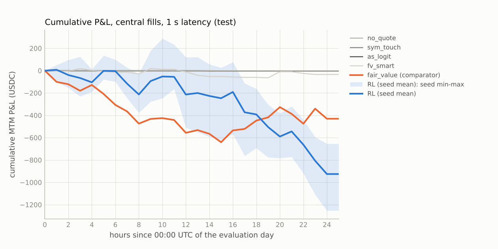
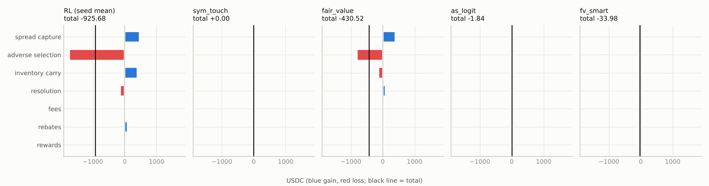
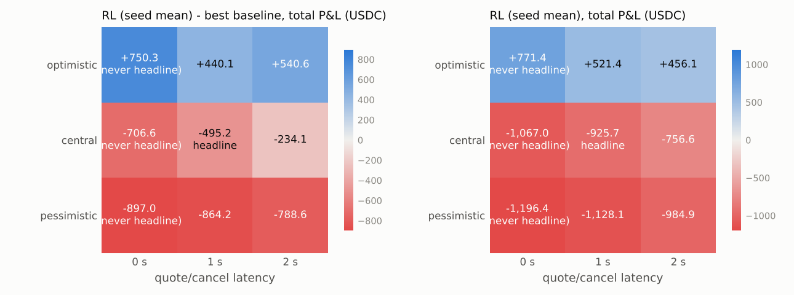

# Polymarket market making: v2 test results (Jun 15, run once)

**Verdict: FAIL. On the untouched v2 test set the selected RL policy loses $926, about $3.21
per market.** It does worse than the pre-registered comparator (fair_value, −$431) and worse
than not quoting ($0).

The primary endpoint, RL minus fair_value at central fills and 1 s latency, is **−$495**, 95%
block-bootstrap CI **[−$1,610, +$551]**. Five of the seven success criteria fail.

This was the expected outcome. The selected config already lost on val v2: −$35 at selection
(3 seeds) and −$111 over 5 seeds, against $0 for no-quote and +$101 for fair_value. No method
that counts as making markets had a positive val v2 seed mean (`final/v2/SELECTION.md`).

## Run facts

| item | value |
|---|---|
| test data | `data/build_jun15`: every BTC 5-minute up/down market of 2026-06-15 (288 markets) |
| plan | `final/v2/TEST_PLAN.json`, sha256 `72c84da5a31877fa5c8c883d2797381e800a39c39331cd8b52e675e94159a2dc`, frozen and pushed before the run (commit `d3eb1b6`, eval/EVALUATION.md amendment log) |
| run | once: `test-2026-10-15T221819+0000`, 168 of 168 runs in 1,027 s; no crash, no rerun |
| env | `mm.h` sha256 `9189f83a…`, `mark_mode = 1` (DECISIONS.md D13.4) |
| replay check | C replay matched with max state difference 0 |

## v2 summary

### What was tested
- **RL policy:** `v2s1/c00`, quoting every contract length.
  - Reward-mode-2 MLP with a 60 s fill markout and a fair-value mark.
  - Seeds 0–4, greedy actions.
- **How it was chosen:** DECISIONS.md D8, with D1.3 judged as in D13 (reading C). Readings A and
  B and the ensemble candidates would have picked differently. Two of those alternative winners
  quote only 15m and 4h markets, so they would quote nothing on this 5m-only test.
- **Comparators** (D7 keeps D1): the v1 tuned baselines.
  - Primary comparator: `fair_value`.
  - Secondary comparators (D1.2): the activity-constrained ("active") baselines.

### Primary endpoint and decision rule

| criterion (all required) | verdict | value |
|---|---|---|
| primary endpoint: RL − fair_value, central, 1 s; 95% CI lower bound > 0 | **FAIL** | −495.16 [−1,609.81, +550.93] |
| point estimate > 0, pessimistic fills, 1 s | **FAIL** | −864.23 |
| point estimate > 0, central fills, 2 s | **FAIL** | −234.10 |
| not directional (T6) | PASS | inventory P&L +249 = 31% of the positive components; total < 0 |
| no invalidating exploit flag (T5) | PASS | the fill edge is negative (−6,314), so the share rule does not apply |
| counts as market making (D1.3) | PASS | 25.9 fills/market; two-sided only 1% of the time, any quote 36% |
| ex-top-5 markets and ex-top-3 hours > 0 (T7) | **FAIL** | −1,206.17 and −1,204.05 |

### Headline: central fills, 1 s latency, every comparator

| method | P&L (288 markets) | per market | RL minus it [95% CI] |
|---|---:|---:|---:|
| **RL `v2s1/c00`, seed mean of 5** | **−925.68** | −3.21 | |
| no_quote | 0.00 | 0.00 | −925.68 [−1,626.15, −221.80] |
| **fair_value (pre-registered comparator)** | −430.52 | −1.49 | **−495.16 [−1,609.81, +550.93]** |
| as_logit | −1.84 | −0.01 | −923.84 [−1,625.48, −219.25] |
| fv_smart | −33.98 | −0.12 | −891.70 [−1,595.89, −185.40] |
| sym_touch | 0.00 | 0.00 | −925.68 [−1,626.15, −221.80] |
| fair_value (active, D1.2) | −101.26 | −0.35 | −824.42 [−1,587.30, −86.90] |
| as_logit (active, D1.2) | −186.34 | −0.65 | −739.34 [−1,421.11, −60.26] |
| fv_smart (active, D1.2) | −1,260.57 | −4.38 | +334.89 [−563.43, +1,256.79] |
| sym_touch (active, D1.2) | −2,104.83 | −7.31 | +1,179.14 [+523.10, +1,828.65] |

- **Where RL ranks.** RL is significantly worse than not quoting, and worse than three of the
  four forced-to-trade baselines. It beats only symmetric quoting at the touch.
- **Every quoting method loses on Jun 15.** The best is as_logit at −$1.84, which barely quotes.

### Fill-model and latency sensitivity (RL seed mean)

| fill model | 0 s | 1 s | 2 s |
|---|---:|---:|---:|
| optimistic | +771.36 | +521.42 | +456.12 |
| **central** | −1,067.02 | **−925.68** | −756.58 |
| pessimistic | −1,196.43 | −1,128.15 | −984.89 |

- **Only the optimistic fill model is positive.** It puts us at the front of the queue and fills
  us on any print at our price.
- **Size sweep** (central, 1 s): ×0.5 −503, ×1 −926, ×2 −1,335.

### Where the money goes (RL seed mean, central, 1 s)

| component | P&L |
|---|---:|
| spread capture | +472 |
| adverse selection (60 s markout) | −1,735 |
| inventory carry | +396 |
| resolution | −147 |
| rebates | +88 |
| **total** | **−926** |

- **Adverse selection is the loss, as in v1.**
  - Markouts are already −468 at +1 s and −1,307 at +5 s.
  - So the policy is picked off within seconds of each fill.
- **The mirror test is unchanged:** +231 [−187, +616].
- **By outcome.** P&L is +166 on Up-won markets and −1,092 on Down-won markets.

### Seeds (central, 1 s)

| seed | 0 | 1 | 2 | 3 | 4 | mean | std |
|---|---:|---:|---:|---:|---:|---:|---:|
| Jun 15 test | −1,164.29 | −654.11 | −1,252.30 | −779.82 | −777.89 | −925.68 | 264.80 |
| val v2 (374 markets) | −184.97 | −69.46 | +149.54 | −362.09 | −87.85 | −110.97 | 186.2 |

- **Every seed loses on the test.** The best seed loses $654.
- **Selection used seeds 0–2 only.** Seeds 3 and 4 were trained afterwards with the same config.

### T5, T6 and T7

- **T5: valid.** The total fill edge is negative, so no artifact flag can carry more than 25% of
  a positive edge. Flagged fills on the D2 artifact flags, pooled over seeds:

  | flag | fills |
  |---|---:|
  | inspread | 3,977 |
  | onesided | 4,170 |
  | last30 | 2,524 |
  | crossed or stale | 126 |

  Excluding all flagged fills, the edge is −4,357.
- **T6: market making, not directional.**
  - Inventory P&L is 31% of the positive components.
  - The correlation of inventory with the next 60 s return is −0.02.
  - The mirror test is unchanged.
- **T7: fails.**
  - Without the top 5 markets, P&L is −1,206; without the top 3 hours, −1,204.
  - 51% of markets and 32% of hours are positive.

### D10 sensitivity: fills on `book_valid = 0` rows removed (reported, not used to judge)

58 of the 288 Jun 15 markets have no Marketlens book for their first 3–201 s (2,987 rows). The
table re-computes P&L with every fill on those rows removed (`final/v2/d10_book_valid.py`). This
is a static counterfactual: later quotes and inventory are not re-simulated. Fill contributions
plus rewards reproduce each run's P&L to 9e-13.

| | P&L | fills on book_valid=0 rows | their P&L | P&L without them |
|---|---:|---:|---:|---:|
| RL seed mean, central 1 s | −925.68 | 649 of 7,448 per seed (172–928; 23–51 markets) | −444.19 | **−481.49** |
| RL seed mean, pessimistic 1 s | −1,128.15 | 1,313 | −427.39 | −700.76 |
| RL seed mean, optimistic 1 s | +521.42 | 631 | −418.15 | +939.56 |
| every baseline, every variant | as above | 0 | 0 | unchanged |

**About half of RL's central loss comes from quoting into markets that have no book yet.** The
baselines never quote there.
- **These are source-shift rows.** The v1 data has the same pattern (57 of its 471 5m markets),
  but in the v1 test RL had 0 fills on such rows (same script on `final/results/test`).
- **Why Jun 15 fills there and v1 did not is not established here.** One candidate: data-api
  prints during Marketlens' bookless seconds reaching a resting quote.
- **The verdict stands without these fills.** RL is still −$481, below no-quote. It is about $51
  below fair_value (static comparison, no CI).

### What this test can and cannot show (D7 caveats, stated before the run)

- **BTC 5-minute markets only.** The policy was trained and selected on 8 coins and 5m, 15m and 4h
  contracts. On val v2 its only profitable segment was the 4h markets (+$222 on 32 markets over
  3 seeds), and those are absent here. A loss on 5m markets is in line with val v2, where the
  three selection seeds averaged −$209 on the 223 5m markets.
- **Different capture: Marketlens.** Millisecond deltas replayed to 1 s rows, against
  PolyOrderBooks 1 s snapshots in training. Known differences:
  - `book_age` means something else (D10);
  - snapshot/delta disagreements (TEST_LOCK.md);
  - bookless market openings, see D10.

  Fills come from the same data-api source as in training.
- **Out of period.** Jun 15 is two months before the Aug 21–24 training and validation data, not a
  walk-forward day. The day had 31.6 bp per √hour of Binance 1 s volatility, 33,493 taker trades
  per market-hour and a 1.12 c two-sided spread. 12.8% of rows had no two-sided book.
- **The result says something about robustness under a shift in source and time period, not about
  the full portfolio.**
- **The test was evaluated exactly once.**

### Other notes

- **v1 env mismatch (D13.4).** The v1 test ran the R7 policies with `mark_mode = 0`, while they
  had been trained with `mark_mode = 1`. Their wealth input was therefore off-distribution in v1.
  The v2 plan uses the training value, and the val dry run reproduced every training-time val
  number exactly.
- **Multiple testing.** N = 3,617 val evaluations over 2,152 configs, across every ledger.
- **Reading the generated report below.**
  - `final/report.py`'s regime table (§12) shows only the test day: the Jun 15 build has no
    train or val rows.
  - "Post hoc best baseline on this split" is sym_touch, which never quotes.

---

*Everything below is generated by `final/report.py` from `final/v2/results/test`, unchanged.*

Generated 2026-10-15T22:35:47+00:00 by `final/report.py` from `final/v2/results/test`; plan sha256 `72c84da5a31877fa5c8c883d2797381e800a39c39331cd8b52e675e94159a2dc`; run `test-2026-10-15T221819+0000`; 288 markets; bootstrap stationary, 10000 replicates, block length Politis-White floored at 2 h.

## 1. Primary endpoint and decision rule

test-day total P&L of the selected RL config (seed mean) minus the best tuned baseline, central fills, 1 s latency, rewards+rebates included. Comparator (fixed in the plan): **fair_value** (highest val P&L (central fills, 1 s) in tuned.json among the tuned baselines and no-quote (DECISIONS.md D1.1)).

Protocol amendments applied (eval/DECISIONS.md, sha256 `af4ccfd1f3d08018`): D1 comparators (no-quote a candidate; constrained secondary baselines; market-making classification); D2 T5 rule on artifact flags only.

| statistic | estimate | 95% CI | block length (h) | hours | corr(RL, baseline) |
| :--- | ---: | ---: | ---: | ---: | ---: |
| RL seed mean - best baseline, total P&L | -495.16 | [-1,609.81, +550.93] | 2.0 | 25 | 0.07 |

| criterion (all required) | verdict | detail |
| :--- | :--- | :--- |
| primary endpoint 95% CI lower bound > 0 | FAIL | CI lower bound -1,609.81 |
| point estimate > 0 under pessimistic fills at 1 s | FAIL | point estimate -864.23 |
| point estimate > 0 under central fills at 2 s | FAIL | point estimate -234.10 |
| RL (seed mean) not classified directional (T6) | PASS | inventory share of total n/a, of positive components 31% |
| no invalidating exploit flag (T5), seed-pooled fills | PASS | worst artifact flag None n/a of the fill edge; edge excl. flagged -4,357.09 (D2 flags) |
| RL counts as making markets: >= 5 fills per market, T6 share <= 50%, T5 artifact share <= 25% (D1.3) | PASS | makes markets: 25.9 fills/market, two-sided uptime 1% (D1.3) |
| RL seed-mean P&L excluding the top 5 markets and excluding the top 3 hours both > 0 (T7) | FAIL | ex-top-5 markets -1,206.17, ex-top-3 hours -1,204.05 |

**Overall: FAIL** (the decision rule of EVALUATION.md section 4).

## 2. Headline: central fills, 1 s latency, size x1

| method | P&L total | P&L/day | mean/market | median/market | P&L ex rewards+rebates | hourly Sharpe [95% CI] | CVaR95/market | fills | fills per quoted min | share of taker vol | uptime 2-sided | uptime 1-sided | max |inv| | max portfolio delta $ |
| :--- | ---: | ---: | ---: | ---: | ---: | ---: | ---: | ---: | ---: | ---: | ---: | ---: | ---: | ---: |
| no_quote | +0.00 | +0.00 | +0.000 | +0.000 | +0.00 | n/a | +0.000 | 0 | n/a | 0.00% | 0.0% | 0.0% | 0.0 | 0 |
| sym_touch | +0.00 | +0.00 | +0.000 | +0.000 | +0.00 | n/a | +0.000 | 0 | n/a | 0.00% | 0.0% | 0.0% | 0.0 | 0 |
| fair_value | -430.52 | -430.52 | -1.495 | +0.000 | -466.15 | -0.24 [-0.71, +0.14] | -37.317 | 1,941 | 3.78 | 0.06% | 2.1% | 5.0% | 100.0 | 580,484 |
| as_logit | -1.84 | -1.84 | -0.006 | +0.000 | -2.00 | -0.39 [-0.62, -0.20] | -0.145 | 64 | 0.13 | 0.00% | 0.0% | 6.6% | 15.0 | 844 |
| fv_smart | -33.98 | -33.98 | -0.118 | +0.000 | -36.40 | -0.07 [-0.76, +0.24] | -10.134 | 212 | 3.31 | 0.01% | 0.0% | 0.2% | 100.0 | 142,314 |
| sym_touch (active) | -2,104.83 | -2,104.83 | -7.308 | -6.919 | -2,331.17 | -3.35 [-6.52, -2.28] | -18.227 | 26,151 | 17.00 | 0.43% | 10.8% | 69.7% | 21.1 | 75,705 |
| fair_value (active) | -101.26 | -101.26 | -0.352 | +0.000 | -133.37 | -0.22 [-0.51, -0.01] | -9.955 | 3,437 | 5.80 | 0.06% | 8.2% | 2.4% | 40.0 | 83,045 |
| as_logit (active) | -186.34 | -186.34 | -0.647 | -0.376 | -201.94 | -0.87 [-1.71, -0.65] | -5.664 | 4,301 | 4.04 | 0.07% | 15.0% | 21.8% | 35.0 | 41,450 |
| fv_smart (active) | -1,260.57 | -1,260.57 | -4.377 | -9.365 | -1,422.52 | -0.46 [-0.80, -0.16] | -78.233 | 12,204 | 13.17 | 0.29% | 1.8% | 31.0% | 100.0 | 623,913 |
| **RL (seed mean)** | -925.68 | -925.68 | -3.214 | +1.308 | -1,013.70 | -0.46 [-0.89, -0.11] | -57.755 | 7,448 | 6.34 | 0.16% | 0.6% | 35.8% | 100.0 | 526,132 |

Sharpe is per hour (not annualised) on the zero-filled hourly MTM grid summed over all markets. CVaR95 is the mean of the worst 5% of per-market P&L. Uptime is over live seconds. For the RL rows every number is the seed mean (max |inv| and portfolio delta: mean over seeds of the max).

## 3. Paired differences vs every baseline (hourly blocks, identical markets)

| method | minus | diff (with rewards+rebates) | 95% CI | diff (floor: without) | 95% CI | corr |
| :--- | ---: | ---: | ---: | ---: | ---: | ---: |
| RL (seed mean) | no_quote | -925.68 | [-1,626.15, -221.80] | -1,013.70 | [-1,715.15, -306.95] | n/a |
| RL (seed mean) | sym_touch | -925.68 | [-1,626.15, -221.80] | -1,013.70 | [-1,715.15, -306.95] | n/a |
| RL (seed mean) | fair_value (comparator) | -495.16 | [-1,609.81, +550.93] | -547.55 | [-1,663.75, +499.68] | 0.07 |
| RL (seed mean) | as_logit | -923.84 | [-1,625.48, -219.25] | -1,011.70 | [-1,713.98, -305.18] | -0.24 |
| RL (seed mean) | fv_smart | -891.70 | [-1,595.89, -185.40] | -977.29 | [-1,683.79, -268.74] | 0.21 |
| RL (seed mean) | sym_touch (active) (secondary, D1.2) | +1,179.14 | [+523.10, +1,828.65] | +1,317.47 | [+657.61, +1,970.73] | 0.18 |
| RL (seed mean) | fair_value (active) (secondary, D1.2) | -824.42 | [-1,587.30, -86.90] | -880.32 | [-1,645.12, -141.68] | -0.13 |
| RL (seed mean) | as_logit (active) (secondary, D1.2) | -739.34 | [-1,421.11, -60.26] | -811.75 | [-1,493.92, -132.52] | 0.31 |
| RL (seed mean) | fv_smart (active) (secondary, D1.2) | +334.89 | [-563.43, +1,256.79] | +408.83 | [-495.57, +1,336.95] | 0.72 |

Post hoc (secondary, conservative): the best tuned baseline on this split is **sym_touch** (+0.00); the pre-registered comparator is fair_value.

## 4. Attribution (T6) and markouts

| method | spread capture | adverse selection | inventory carry | resolution | fees | rebates | rewards | total | identity err | vs cash |
| :--- | ---: | ---: | ---: | ---: | ---: | ---: | ---: | ---: | ---: | ---: |
| RL (seed mean) | +471.96 | -1,734.75 | +396.06 | -146.96 | +0.00 | +88.01 | +0.00 | -925.68 | 5.7e-14 | 7.1e-14 |
| no_quote | +0.00 | +0.00 | +0.00 | +0.00 | +0.00 | +0.00 | +0.00 | +0.00 | 0.0e+00 | 0.0e+00 |
| sym_touch | +0.00 | +0.00 | +0.00 | +0.00 | +0.00 | +0.00 | +0.00 | +0.00 | 0.0e+00 | 0.0e+00 |
| fair_value | +396.05 | -815.32 | -128.74 | +81.86 | +0.00 | +35.63 | +0.00 | -430.52 | 5.3e-14 | 2.8e-14 |
| as_logit | +3.63 | -6.28 | +6.27 | -5.62 | +0.00 | +0.16 | +0.00 | -1.84 | 5.3e-16 | 1.2e-15 |
| fv_smart | +1.79 | -51.36 | +11.54 | +1.62 | +0.00 | +2.42 | +0.00 | -33.98 | 1.4e-14 | 1.8e-14 |
| sym_touch (active) | +379.28 | -2,661.59 | -7.65 | -41.22 | +0.00 | +226.34 | +0.00 | -2,104.83 | 1.3e-14 | 1.4e-14 |
| fair_value (active) | +130.50 | -412.41 | +133.48 | +15.05 | +0.00 | +32.11 | +0.00 | -101.26 | 7.1e-15 | 5.3e-15 |
| as_logit (active) | +312.71 | -517.61 | +56.27 | -53.31 | +0.00 | +15.60 | +0.00 | -186.34 | 6.2e-15 | 6.7e-15 |
| fv_smart (active) | +255.02 | -1,728.51 | +216.00 | -165.04 | +0.00 | +161.95 | +0.00 | -1,260.57 | 5.0e-14 | 4.3e-14 |

spread capture = sq (mid at fill - price); adverse selection = sq (mid +60 s - mid at fill); inventory carry = sq (mid at 10 s before close - mid +60 s); resolution = sq (settlement - that mid); fees < 0; rebates and liquidity rewards. Components sum to the total; 'identity err' is stats.attribute_pnl's check and 'vs cash' the max per-market difference from the env's own cash accounting.

Markouts (sum of sq x (mid at +h - mid at fill), USDC):

| method | +1 s | +5 s | +10 s | +30 s | +60 s |
| :--- | ---: | ---: | ---: | ---: | ---: |
| RL (seed mean) | -468.31 | -1,307.13 | -1,381.23 | -1,658.17 | -1,734.75 |
| no_quote | +0.00 | +0.00 | +0.00 | +0.00 | +0.00 |
| sym_touch | +0.00 | +0.00 | +0.00 | +0.00 | +0.00 |
| fair_value | -263.12 | -756.53 | -750.56 | -696.81 | -815.32 |
| as_logit | -2.80 | -5.40 | -7.33 | -6.08 | -6.28 |
| fv_smart | -8.18 | -29.02 | -25.76 | +14.06 | -51.36 |
| sym_touch (active) | -957.37 | -2,586.19 | -2,628.90 | -2,672.85 | -2,661.59 |
| fair_value (active) | -151.07 | -415.59 | -422.17 | -432.21 | -412.41 |
| as_logit (active) | -206.33 | -502.69 | -492.96 | -549.83 | -517.61 |
| fv_smart (active) | -574.46 | -1,655.21 | -1,712.69 | -1,878.11 | -1,728.51 |

## 5. Exploit detectors (T5, DECISIONS.md D2) and market-making status (D1.3)

| method | inspread | crossed_or_stale | onesided | last30 | fill edge | excl. flagged | verdict |
| :--- | ---: | ---: | ---: | ---: | ---: | ---: | ---: |
| RL (seed mean) | n/a (3977) | n/a (126) | n/a (4170) | n/a (2524) | -6,313.93 | -4,357.09 | valid |
| no_quote | n/a (0) | n/a (0) | n/a (0) | n/a (0) | +0.00 | +0.00 | valid |
| sym_touch | n/a (0) | n/a (0) | n/a (0) | n/a (0) | +0.00 | +0.00 | valid |
| fair_value | n/a (6) | n/a (11) | n/a (5) | n/a (0) | -419.27 | -378.17 | valid |
| as_logit | n/a (0) | n/a (0) | n/a (12) | n/a (28) | -2.65 | -1.90 | valid |
| fv_smart | n/a (1) | n/a (0) | n/a (0) | n/a (0) | -49.56 | -50.93 | valid |
| sym_touch (active) | n/a (596) | n/a (84) | n/a (242) | n/a (1287) | -2,282.30 | -2,108.88 | valid |
| fair_value (active) | n/a (55) | n/a (27) | n/a (7) | n/a (0) | -281.91 | -279.23 | valid |
| as_logit (active) | n/a (88) | n/a (14) | n/a (178) | n/a (937) | -204.90 | -177.61 | valid |
| fv_smart (active) | n/a (341) | n/a (59) | n/a (113) | n/a (104) | -1,473.48 | -1,441.46 | valid |

Artifact flags of D2 (the T5 rule): share of the total fill edge (per fill: spread capture + 60 s markout, the env's pnl_X) from fills under the flag (number of fills); n/a when the total edge is <= 0. Invalid if one of them carries > 25%, or the edge excluding all of them is <= 0 while the total is > 0. RL rows pool the seeds' fills.

Every flag, edge share / volume share (the through-the-touch `outside` flag is reported, not a detector, D2):

| method | crossed | stale | onesided | last30 | last10 | inside2 | extreme | outside | inspread | crossed_or_stale |
| :--- | ---: | ---: | ---: | ---: | ---: | ---: | ---: | ---: | ---: | ---: |
| RL (seed mean) | n/a / 0% | n/a / 0% | n/a / 11% | n/a / 7% | n/a / 2% | n/a / 3% | n/a / 4% | n/a / 78% | n/a / 11% | n/a / 0% |
| no_quote | n/a / n/a | n/a / n/a | n/a / n/a | n/a / n/a | n/a / n/a | n/a / n/a | n/a / n/a | n/a / n/a | n/a / n/a | n/a / n/a |
| sym_touch | n/a / n/a | n/a / n/a | n/a / n/a | n/a / n/a | n/a / n/a | n/a / n/a | n/a / n/a | n/a / n/a | n/a / n/a | n/a / n/a |
| fair_value | n/a / 0% | n/a / 1% | n/a / 0% | n/a / 0% | n/a / 0% | n/a / 3% | n/a / 0% | n/a / 96% | n/a / 0% | n/a / 1% |
| as_logit | n/a / 0% | n/a / 0% | n/a / 16% | n/a / 40% | n/a / 20% | n/a / 4% | n/a / 62% | n/a / 67% | n/a / 0% | n/a / 0% |
| fv_smart | n/a / 0% | n/a / 0% | n/a / 0% | n/a / 0% | n/a / 0% | n/a / 7% | n/a / 0% | n/a / 73% | n/a / 1% | n/a / 0% |
| sym_touch (active) | n/a / 0% | n/a / 0% | n/a / 1% | n/a / 5% | n/a / 1% | n/a / 5% | n/a / 4% | n/a / 80% | n/a / 2% | n/a / 0% |
| fair_value (active) | n/a / 0% | n/a / 1% | n/a / 0% | n/a / 0% | n/a / 0% | n/a / 3% | n/a / 1% | n/a / 87% | n/a / 1% | n/a / 1% |
| as_logit (active) | n/a / 0% | n/a / 0% | n/a / 5% | n/a / 22% | n/a / 6% | n/a / 2% | n/a / 17% | n/a / 82% | n/a / 2% | n/a / 0% |
| fv_smart (active) | n/a / 0% | n/a / 0% | n/a / 1% | n/a / 1% | n/a / 0% | n/a / 4% | n/a / 4% | n/a / 76% | n/a / 3% | n/a / 0% |

Flags (judged on the book at the match second, as the env does): `crossed` book crossed in the raw data (last uncrossed book forward-filled); `stale` book_age > 10 s; `onesided` either side of the book empty; `last30` fewer than 30 s to the close (end - tau < 30); `last10` fewer than 10 s to the close; `inside2` our quote more than 2 ticks inside the touch; `extreme` our quote <= 0.02 or >= 0.98; `outside` the print is outside [best bid, best ask] (includes every sweep through the touch; reported, not an exploit detector: DECISIONS.md D2); `inspread` the print is on the wrong side of the hit touch (a sell above the best bid or a buy below the best ask): the snapshot cannot explain it; `crossed_or_stale` crossed or stale book (union).

D1.3: a policy counts as making markets only with >= 5 fills per market, T6 directional share <= 50% and T5 artifact share <= 25%; otherwise this table says what it does instead.

| method | makes markets | what it does | fills/market | uptime 2-sided | uptime any | markets without fills | failed |
| :--- | ---: | ---: | ---: | ---: | ---: | ---: | ---: |
| RL (seed mean) | yes | makes markets | 25.9 | 1% | 36% | 0% | - |
| no_quote | **no** | mostly does not quote | 0.0 | 0% | 0% | 100% | fills |
| sym_touch | **no** | mostly does not quote | 0.0 | 0% | 0% | 100% | fills |
| fair_value | yes | makes markets | 6.7 | 2% | 7% | 50% | - |
| as_logit | **no** | mostly does not quote | 0.2 | 0% | 7% | 93% | fills |
| fv_smart | **no** | mostly does not quote | 0.7 | 0% | 0% | 90% | fills, t6 |
| sym_touch (active) | yes | makes markets | 90.8 | 11% | 80% | 0% | - |
| fair_value (active) | yes | makes markets | 11.9 | 8% | 11% | 31% | - |
| as_logit (active) | yes | makes markets | 14.9 | 15% | 37% | 1% | - |
| fv_smart (active) | yes | makes markets | 42.4 | 2% | 33% | 0% | - |

Fills by time to close (all methods, headline; a policy that only trades in the last seconds is suspect):

| method | <=10 s | 10-30 s | 30-60 s | 1-5 min | 5-15 min | >15 min |
| :--- | ---: | ---: | ---: | ---: | ---: | ---: |
| RL (seed mean) | 2.0% | 5.1% | 6.3% | 86.6% | 0.0% | 0.0% |
| no_quote | 0.0% | 0.0% | 0.0% | 0.0% | 0.0% | 0.0% |
| sym_touch | 0.0% | 0.0% | 0.0% | 0.0% | 0.0% | 0.0% |
| fair_value | 0.0% | 0.0% | 0.0% | 100.0% | 0.0% | 0.0% |
| as_logit | 23.4% | 21.9% | 18.8% | 35.9% | 0.0% | 0.0% |
| fv_smart | 0.0% | 0.0% | 0.0% | 100.0% | 0.0% | 0.0% |
| sym_touch (active) | 1.0% | 4.3% | 8.2% | 86.6% | 0.0% | 0.0% |
| fair_value (active) | 0.0% | 0.0% | 0.0% | 100.0% | 0.0% | 0.0% |
| as_logit (active) | 7.5% | 15.6% | 23.2% | 53.7% | 0.0% | 0.0% |
| fv_smart (active) | 0.0% | 1.1% | 6.5% | 92.3% | 0.0% | 0.0% |

## 6. Directional gambling (T6) and the mirror test

| method | inventory P&L | share of total | share of positive | class | P&L Up-won mkts | P&L Down-won mkts | corr(inv, next 60 s return) | mirror - original [95% CI] |
| :--- | ---: | ---: | ---: | ---: | ---: | ---: | ---: | ---: |
| RL (seed mean) | +249.09 | n/a | 31% | market making | +165.89 | -1,091.58 | -0.023 | +230.73 [-187.14, +615.73] unchanged |
| no_quote | +0.00 | n/a | n/a | market making | +0.00 | +0.00 | n/a | +0.00 [+0.00, +0.00] unchanged |
| sym_touch | +0.00 | n/a | n/a | market making | +0.00 | +0.00 | n/a | +0.00 [+0.00, +0.00] unchanged |
| fair_value | -46.88 | n/a | -11% | market making | -164.00 | -266.52 | -0.011 | -0.00 [-0.00, +0.00] unchanged |
| as_logit | +0.65 | n/a | 15% | market making | -0.42 | -1.42 | +0.011 | -0.20 [-0.61, +0.00] unchanged |
| fv_smart | +13.16 | n/a | 76% | **DIRECTIONAL** | -13.05 | -20.93 | -0.007 | +0.00 [-0.00, +0.00] unchanged |
| sym_touch (active) | -48.87 | n/a | -8% | market making | -1,099.97 | -1,004.86 | -0.028 | +0.00 [-0.00, +0.00] unchanged |
| fair_value (active) | +148.54 | n/a | 48% | market making | -55.20 | -46.06 | +0.045 | +0.00 [-0.00, +0.00] unchanged |
| as_logit (active) | +2.96 | n/a | 1% | market making | -90.72 | -95.62 | -0.005 | -0.00 [-0.00, +0.00] unchanged |
| fv_smart (active) | +50.96 | n/a | 11% | market making | -0.57 | -1,260.00 | -0.014 | -0.00 [-0.00, +0.00] unchanged |

## 7. Concentration (T7)

| method | total | top-1 mkt | top-5 mkts | top-10 mkts | ex top-5 mkts | eff. # mkts | # mkts for half profit | mkts > 0 | top-1 hour | ex top-3 hours | hours > 0 |
| :--- | ---: | ---: | ---: | ---: | ---: | ---: | ---: | ---: | ---: | ---: | ---: |
| RL (seed mean) | -925.68 | n/a | n/a | n/a | -1,206.17 | 206.1 | 42 | 51% | n/a | -1,204.05 | 32% |
| no_quote | +0.00 | n/a | n/a | n/a | +0.00 | n/a | 0 | 0% | n/a | +0.00 | 0% |
| sym_touch | +0.00 | n/a | n/a | n/a | +0.00 | n/a | 0 | 0% | n/a | +0.00 | 0% |
| fair_value | -430.52 | n/a | n/a | n/a | -774.05 | 92.9 | 12 | 15% | n/a | -762.63 | 44% |
| as_logit | -1.84 | n/a | n/a | n/a | -2.07 | 5.9 | 2 | 3% | n/a | -2.07 | 12% |
| fv_smart | -33.98 | n/a | n/a | n/a | -183.53 | 12.5 | 2 | 1% | n/a | -158.35 | 12% |
| sym_touch (active) | -2,104.83 | n/a | n/a | n/a | -2,108.94 | 216.9 | 1 | 1% | n/a | -1,991.66 | 4% |
| fair_value (active) | -101.26 | n/a | n/a | n/a | -186.86 | 107.8 | 14 | 27% | n/a | -201.08 | 36% |
| as_logit (active) | -186.34 | n/a | n/a | n/a | -217.68 | 91.1 | 5 | 26% | n/a | -192.82 | 4% |
| fv_smart (active) | -1,260.57 | n/a | n/a | n/a | -1,603.95 | 235.0 | 47 | 48% | n/a | -1,592.96 | 36% |

## 8. Fill model x latency grid, size sweep

| method | optimistic 0 s | optimistic 1 s | optimistic 2 s | central 0 s | central 1 s | central 2 s | pessimistic 0 s | pessimistic 1 s | pessimistic 2 s |
| :--- | ---: | ---: | ---: | ---: | ---: | ---: | ---: | ---: | ---: |
| no_quote | +0.00 | +0.00 | +0.00 | +0.00 | +0.00 | +0.00 | +0.00 | +0.00 | +0.00 |
| sym_touch | +0.00 | +0.00 | +0.00 | +0.00 | +0.00 | +0.00 | +0.00 | +0.00 | +0.00 |
| fair_value | +21.03 | +81.35 | -84.46 | -360.46 | -430.52 | -522.48 | -299.46 | -263.92 | -196.32 |
| as_logit | +6.94 | +5.62 | +7.00 | -5.40 | -1.84 | -1.85 | -3.29 | -1.12 | -1.19 |
| fv_smart | +19.42 | -54.48 | +20.11 | -129.77 | -33.98 | -18.43 | -55.42 | -3.68 | -42.38 |
| sym_touch (active) | +2,317.95 | +3,035.93 | +3,038.18 | -2,529.43 | -2,104.83 | -1,552.05 | -2,260.41 | -1,703.18 | -1,436.37 |
| fair_value (active) | +304.13 | +236.02 | +179.53 | -105.72 | -101.26 | -69.96 | -183.23 | -148.65 | -176.49 |
| as_logit (active) | +417.13 | +289.15 | +211.94 | -204.62 | -186.34 | -226.51 | -233.48 | -237.68 | -224.23 |
| fv_smart (active) | +1,417.74 | +1,908.14 | +1,822.98 | -1,251.85 | -1,260.57 | -1,183.94 | -1,873.76 | -1,515.60 | -1,482.84 |
| RL (seed mean) | +771.36 | +521.42 | +456.12 | -1,067.02 | -925.68 | -756.58 | -1,196.43 | -1,128.15 | -984.89 |

RL (seed mean) minus fair_value per cell:

| variant | diff | 95% CI |  |
| :--- | ---: | ---: | ---: |
| optimistic_lat0 | +750.33 | [-14.66, +1,500.59] | never headline |
| optimistic_lat1 | +440.07 | [-431.67, +1,337.01] |  |
| optimistic_lat2 | +540.58 | [-282.68, +1,297.27] |  |
| central_lat0 | -706.56 | [-1,717.99, +267.11] | never headline |
| central_lat1 | -495.16 | [-1,609.81, +550.93] | headline |
| central_lat2 | -234.10 | [-1,281.86, +760.25] |  |
| pessimistic_lat0 | -896.97 | [-1,571.06, -254.60] | never headline |
| pessimistic_lat1 | -864.23 | [-1,528.34, -248.48] |  |
| pessimistic_lat2 | -788.57 | [-1,457.83, -151.27] |  |

Size sweep (central, 1 s). P&L that grows linearly in size well beyond displayed depth is replay optimism, not edge:

| method | x0.5 | x1 | x2 | x2 / x1 |
| :--- | ---: | ---: | ---: | ---: |
| no_quote | +0.00 | +0.00 | +0.00 | n/a |
| sym_touch | +0.00 | +0.00 | +0.00 | n/a |
| fair_value | -229.20 | -430.52 | -801.53 | 1.86 |
| as_logit | -0.89 | -1.84 | -3.68 | 2.00 |
| fv_smart | -24.08 | -33.98 | -50.80 | 1.50 |
| sym_touch (active) | -1,114.84 | -2,104.83 | -3,973.44 | 1.89 |
| fair_value (active) | -65.22 | -101.26 | -353.75 | 3.49 |
| as_logit (active) | -72.87 | -186.34 | -510.26 | 2.74 |
| fv_smart (active) | -897.68 | -1,260.57 | -1,834.87 | 1.46 |
| RL (seed mean) | -503.04 | -925.68 | -1,334.80 | 1.44 |

## 9. By contract length and by coin (headline)

P&L by contract length:

| contract length | markets | no_quote | sym_touch | fair_value | as_logit | fv_smart | sym_touch (active) | fair_value (active) | as_logit (active) | fv_smart (active) | RL (seed mean) |
| :--- | ---: | ---: | ---: | ---: | ---: | ---: | ---: | ---: | ---: | ---: | ---: |
| 5m | 288 | +0.00 | +0.00 | -430.52 | -1.84 | -33.98 | -2,104.83 | -101.26 | -186.34 | -1,260.57 | -925.68 |

P&L by coin:

| coin | markets | no_quote | sym_touch | fair_value | as_logit | fv_smart | sym_touch (active) | fair_value (active) | as_logit (active) | fv_smart (active) | RL (seed mean) |
| :--- | ---: | ---: | ---: | ---: | ---: | ---: | ---: | ---: | ---: | ---: | ---: |
| btc | 288 | +0.00 | +0.00 | -430.52 | -1.84 | -33.98 | -2,104.83 | -101.26 | -186.34 | -1,260.57 | -925.68 |

## 10. Seed spread

RL (seed mean): 5 seeds of the selected config.

| seed | central 1 s | pessimistic 1 s | central 2 s | minus fair_value [95% CI] |
| :--- | ---: | ---: | ---: | ---: |
| rl/seed0 | -1,164.29 | -1,288.05 | -1,202.81 | -733.77 [-1,978.04, +406.95] |
| rl/seed1 | -654.11 | -1,209.78 | -699.34 | -223.59 [-1,434.45, +869.70] |
| rl/seed2 | -1,252.30 | -880.69 | -720.60 | -821.78 [-1,852.80, +187.00] |
| rl/seed3 | -779.82 | -1,466.69 | -715.75 | -349.30 [-1,850.15, +1,098.67] |
| rl/seed4 | -777.89 | -795.54 | -444.40 | -347.37 [-1,361.80, +766.07] |
| **mean** | -925.68 | -1,128.15 | -756.58 |  |
| **std** | +264.80 | +282.27 | +275.14 |  |
| **min** | -1,252.30 | -1,466.69 | -1,202.81 |  |
| **max** | -654.11 | -795.54 | -444.40 |  |

## 11. Multiple testing (T4)

Configurations evaluated on val before the freeze (all `trials.jsonl` ledgers): **N = 3617** evaluations, 2152 distinct configs (0 records without a split field counted as val; 8 annotation rows not counted), by kind {"tune": 831, "variant": 165, "val_eval": 2621}; files: `baselines/trials.jsonl` (996), `train/trials.jsonl` (1655), `train/workers/w1/trials.jsonl` (50), `train/workers/w2/trials.jsonl` (112), `train/workers/w3/trials.jsonl` (18), `train/workers/w4/trials.jsonl` (475), `train/workers/w5/trials.jsonl` (311).

Deflated Sharpe: not available (no hourly Sharpe values in the ledgers, or a flat series).

Run records of this split: 1 started, 1 completed, 0 crashed. Forced reruns: none.

## 12. Regime of the evaluation day (T9)

| split | markets | Binance 1 s vol (bp per sqrt hour) | taker trades per market-hour | two-sided spread (c) | rows without a two-sided book |
| :--- | ---: | ---: | ---: | ---: | ---: |
| test | 288 | 31.6 | 33,493 | 1.12 | 12.8% |

## 13. Run integrity

| check | value |
| :--- | :--- |
| plan sha256 (results / recorded) | 72c84da5a31877fa5c8c883d2797381e800a39c39331cd8b52e675e94159a2dc |
| backend | cenv (of record: True) |
| data files vs plan | 9 files match |
| test rows sha256 | bcdacad4a94232c07eea1a87a788e0a6c788ed4700a5e0673860c4be9235b333 |
| code vs plan | unchanged |
| registration | {"amendment_log": true, "commit_message": true, "skipped": null} |
| reruns | none |
| data snapshot | {"source": "/home/user/MARs/explorations/deep_hedging_cvar/polymarket/data/build_jun15", "n_files": 9} |
| mirrored data (sha256) | meta.json 1b961bda510f, markets.bin 7c072b8e7445, ticks.bin 612e42bb7202, splits.json 5cce77198066, feat.bin 5e949ee3f2ae, feat_meta.json d2dd1e2404c7, book.bin 4bba5088a891, fills.bin 234cc03cfb13, fill_index.bin a62dddaa8bb9 |
| fill flags vs the C Log (vol_X, pnl_X) | max |volume diff| 1.9e-04 shares, max |edge diff| 5.5e-05 USD over 168 runs (float32 Log) |
| C replay (harness + reference) | max |state diff| 0.0e+00, max |C Log P&L - trace| 7.2e-06, runs with mismatches: 0 |
| git commit at plan / now | c2d708dcd950c9fd80e3cf24a43271606006186b / 37333fc3078e64c54debe4f2dc3e25404de92df5 |
| runs | 14 methods x 12 variants in 1026.9 s |
