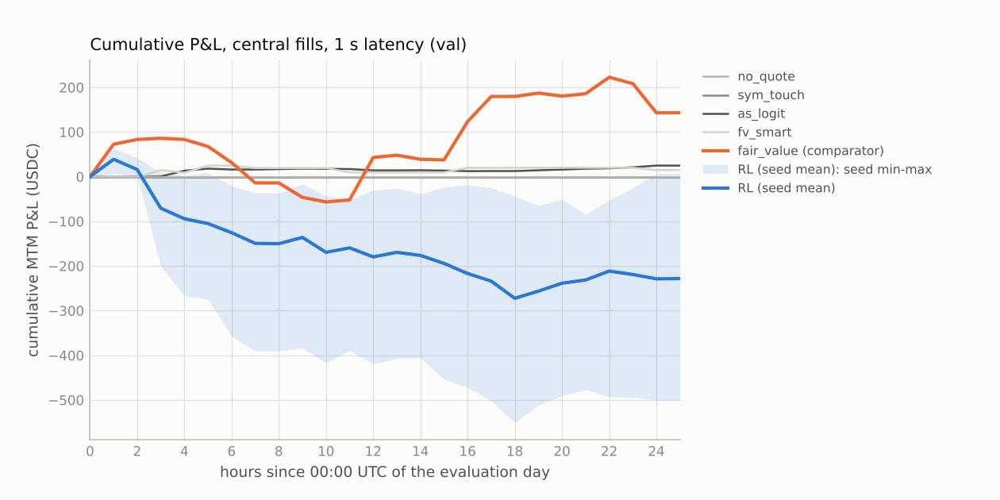
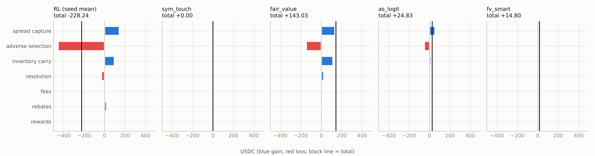
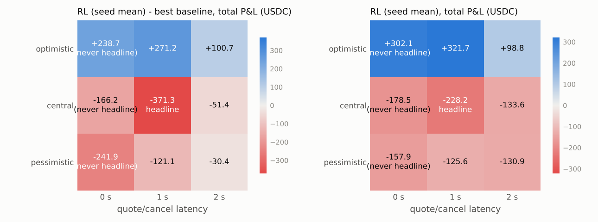

# Polymarket market making: DRY RUN on the validation split (not a test result)

> **DRY RUN** of the final pipeline on split 1 (val). These numbers are NOT test results and were produced after the plan was frozen; they are not used for selection.

Generated 2026-10-15T21:38:02+00:00 by `final/report.py` from `final/v2/dryrun/results/val`; plan sha256 `fa73762cc8af70603db2e6a31bf2a20d7577aa0cb3624ce8f093db89f65f45b3`; run `val-2026-10-15T210343+0000`; 247 markets; bootstrap stationary, 10000 replicates, block length Politis-White floored at 2 h.

## 1. Primary endpoint and decision rule

test-day total P&L of the selected RL config (seed mean) minus the best tuned baseline, central fills, 1 s latency, rewards+rebates included. Comparator (fixed in the plan): **fair_value** (highest val P&L (central fills, 1 s) in tuned.json among the tuned baselines and no-quote (DECISIONS.md D1.1)).

Protocol amendments applied (eval/DECISIONS.md, sha256 `768860584e96befb`): D1 comparators (no-quote a candidate; constrained secondary baselines; market-making classification); D2 T5 rule on artifact flags only.

| statistic | estimate | 95% CI | block length (h) | hours | corr(RL, baseline) |
| :--- | ---: | ---: | ---: | ---: | ---: |
| RL seed mean - best baseline, total P&L | -371.27 | [-832.23, +55.70] | 2.0 | 25 | 0.11 |

| criterion (all required) | verdict | detail |
| :--- | :--- | :--- |
| primary endpoint 95% CI lower bound > 0 | FAIL | CI lower bound -832.23 |
| point estimate > 0 under pessimistic fills at 1 s | FAIL | point estimate -121.08 |
| point estimate > 0 under central fills at 2 s | FAIL | point estimate -51.45 |
| RL (seed mean) not classified directional (T6) | PASS | inventory share of total n/a, of positive components 28% |
| no invalidating exploit flag (T5), seed-pooled fills | PASS | worst artifact flag None n/a of the fill edge; edge excl. flagged -1,231.25 (D2 flags) |
| RL counts as making markets: >= 5 fills per market, T6 share <= 50%, T5 artifact share <= 25% (D1.3) | PASS | makes markets: 16.8 fills/market, two-sided uptime 9% (D1.3) |
| RL seed-mean P&L excluding the top 5 markets and excluding the top 3 hours both > 0 (T7) | FAIL | ex-top-5 markets -354.84, ex-top-3 hours -304.75 |

**Overall: FAIL** (the decision rule of EVALUATION.md section 4).

## 2. Headline: central fills, 1 s latency, size x1

| method | P&L total | P&L/day | mean/market | median/market | P&L ex rewards+rebates | hourly Sharpe [95% CI] | CVaR95/market | fills | fills per quoted min | share of taker vol | uptime 2-sided | uptime 1-sided | max |inv| | max portfolio delta $ |
| :--- | ---: | ---: | ---: | ---: | ---: | ---: | ---: | ---: | ---: | ---: | ---: | ---: | ---: | ---: |
| no_quote | +0.00 | +0.00 | +0.000 | +0.000 | +0.00 | n/a | +0.000 | 0 | n/a | 0.00% | 0.0% | 0.0% | 0.0 | 0 |
| sym_touch | +0.00 | +0.00 | +0.000 | +0.000 | +0.00 | n/a | +0.000 | 0 | n/a | 0.00% | 0.0% | 0.0% | 0.0 | 0 |
| fair_value | +143.03 | +143.03 | +0.579 | +0.000 | +129.78 | +0.15 [-0.32, +0.54] | -22.056 | 1,262 | 0.53 | 0.33% | 8.2% | 6.9% | 100.0 | 185,592 |
| as_logit | +24.83 | +24.83 | +0.101 | +0.000 | +20.94 | +0.33 [-0.06, +0.67] | -1.173 | 1,353 | 0.22 | 0.19% | 70.4% | 10.8% | 45.8 | 4,859 |
| fv_smart | +14.80 | +14.80 | +0.060 | +0.000 | +14.16 | +0.10 [-0.36, +0.38] | -2.467 | 88 | 0.69 | 0.03% | 0.0% | 0.4% | 99.1 | 45,211 |
| sym_touch (active) | -521.14 | -521.14 | -2.110 | -1.114 | -568.99 | -1.54 [-2.06, -1.30] | -12.342 | 11,581 | 1.68 | 1.38% | 30.6% | 67.0% | 20.0 | 37,862 |
| fair_value (active) | -113.93 | -113.93 | -0.461 | +0.000 | -133.23 | -0.43 [-0.92, -0.07] | -9.962 | 5,415 | 1.43 | 0.54% | 28.1% | 6.7% | 40.0 | 59,408 |
| as_logit (active) | -74.21 | -74.21 | -0.300 | -0.051 | -80.60 | -0.52 [-0.99, -0.19] | -5.365 | 3,390 | 0.75 | 0.40% | 35.5% | 18.3% | 38.3 | 40,302 |
| fv_smart (active) | -512.46 | -512.46 | -2.075 | +0.000 | -582.51 | -0.36 [-1.02, +0.07] | -61.558 | 13,850 | 2.34 | 2.11% | 26.0% | 56.8% | 100.0 | 461,131 |
| **RL (seed mean)** | -228.24 | -228.24 | -0.924 | +0.000 | -247.96 | -0.37 [-0.79, +0.02] | -26.913 | 4,138 | 0.67 | 0.59% | 9.5% | 56.9% | 100.0 | 280,071 |

Sharpe is per hour (not annualised) on the zero-filled hourly MTM grid summed over all markets. CVaR95 is the mean of the worst 5% of per-market P&L. Uptime is over live seconds. For the RL rows every number is the seed mean (max |inv| and portfolio delta: mean over seeds of the max).

## 3. Paired differences vs every baseline (hourly blocks, identical markets)

| method | minus | diff (with rewards+rebates) | 95% CI | diff (floor: without) | 95% CI | corr |
| :--- | ---: | ---: | ---: | ---: | ---: | ---: |
| RL (seed mean) | no_quote | -228.24 | [-485.50, +10.78] | -247.96 | [-507.55, -8.14] | n/a |
| RL (seed mean) | sym_touch | -228.24 | [-485.50, +10.78] | -247.96 | [-507.55, -8.14] | n/a |
| RL (seed mean) | fair_value (comparator) | -371.27 | [-832.23, +55.70] | -377.74 | [-837.80, +49.37] | 0.11 |
| RL (seed mean) | as_logit | -253.06 | [-525.22, -11.02] | -268.90 | [-543.30, -26.45] | -0.02 |
| RL (seed mean) | fv_smart | -243.04 | [-536.00, +21.46] | -262.12 | [-557.55, +2.27] | -0.42 |
| RL (seed mean) | sym_touch (active) (secondary, D1.2) | +292.90 | [+55.95, +520.75] | +321.03 | [+86.29, +550.17] | 0.33 |
| RL (seed mean) | fair_value (active) (secondary, D1.2) | -114.30 | [-364.43, +107.76] | -114.74 | [-364.52, +106.44] | 0.33 |
| RL (seed mean) | as_logit (active) (secondary, D1.2) | -154.03 | [-402.98, +77.78] | -167.36 | [-418.72, +65.05] | 0.17 |
| RL (seed mean) | fv_smart (active) (secondary, D1.2) | +284.23 | [-270.73, +789.80] | +334.54 | [-220.26, +842.03] | 0.48 |

Post hoc (secondary, conservative): the best tuned baseline on this split is **fair_value** (+143.03); the pre-registered comparator is fair_value.

## 4. Attribution (T6) and markouts

| method | spread capture | adverse selection | inventory carry | resolution | fees | rebates | rewards | total | identity err | vs cash |
| :--- | ---: | ---: | ---: | ---: | ---: | ---: | ---: | ---: | ---: | ---: |
| RL (seed mean) | +143.77 | -454.11 | +94.03 | -31.65 | +0.00 | +19.73 | +0.00 | -228.24 | 5.7e-14 | 5.0e-14 |
| no_quote | +0.00 | +0.00 | +0.00 | +0.00 | +0.00 | +0.00 | +0.00 | +0.00 | 0.0e+00 | 0.0e+00 |
| sym_touch | +0.00 | +0.00 | +0.00 | +0.00 | +0.00 | +0.00 | +0.00 | +0.00 | 0.0e+00 | 0.0e+00 |
| fair_value | +134.09 | -146.78 | +117.09 | +25.37 | +0.00 | +13.26 | +0.00 | +143.03 | 1.1e-14 | 2.1e-14 |
| as_logit | +54.42 | -49.51 | +15.37 | +0.66 | +0.00 | +3.89 | +0.00 | +24.83 | 8.9e-15 | 1.2e-14 |
| fv_smart | +4.28 | +2.12 | +6.98 | +0.78 | +0.00 | +0.64 | +0.00 | +14.80 | 9.8e-15 | 2.4e-14 |
| sym_touch (active) | +106.95 | -656.36 | +7.67 | -27.25 | +0.00 | +47.86 | +0.00 | -521.14 | 8.9e-15 | 8.0e-15 |
| fair_value (active) | +75.35 | -216.53 | +6.34 | +1.61 | +0.00 | +19.29 | +0.00 | -113.93 | 8.0e-15 | 9.0e-15 |
| as_logit (active) | +176.95 | -284.06 | +51.32 | -24.81 | +0.00 | +6.39 | +0.00 | -74.21 | 6.3e-15 | 5.3e-15 |
| fv_smart (active) | +143.23 | -712.35 | -125.17 | +111.78 | +0.00 | +70.04 | +0.00 | -512.46 | 5.7e-14 | 4.3e-14 |

spread capture = sq (mid at fill - price); adverse selection = sq (mid +60 s - mid at fill); inventory carry = sq (mid at 10 s before close - mid +60 s); resolution = sq (settlement - that mid); fees < 0; rebates and liquidity rewards. Components sum to the total; 'identity err' is stats.attribute_pnl's check and 'vs cash' the max per-market difference from the env's own cash accounting.

Markouts (sum of sq x (mid at +h - mid at fill), USDC):

| method | +1 s | +5 s | +10 s | +30 s | +60 s |
| :--- | ---: | ---: | ---: | ---: | ---: |
| RL (seed mean) | -173.58 | -357.04 | -381.13 | -393.56 | -454.11 |
| no_quote | +0.00 | +0.00 | +0.00 | +0.00 | +0.00 |
| sym_touch | +0.00 | +0.00 | +0.00 | +0.00 | +0.00 |
| fair_value | -101.20 | -266.72 | -259.10 | -198.72 | -146.78 |
| as_logit | -26.92 | -50.14 | -50.16 | -55.15 | -49.51 |
| fv_smart | -1.57 | -1.10 | -3.82 | -2.16 | +2.12 |
| sym_touch (active) | -279.85 | -552.09 | -586.43 | -605.58 | -656.36 |
| fair_value (active) | -111.02 | -234.09 | -241.08 | -258.13 | -216.53 |
| as_logit (active) | -102.71 | -203.75 | -230.49 | -246.13 | -284.06 |
| fv_smart (active) | -350.20 | -725.43 | -744.00 | -800.05 | -712.35 |

## 5. Exploit detectors (T5, DECISIONS.md D2) and market-making status (D1.3)

| method | inspread | crossed_or_stale | onesided | last30 | fill edge | excl. flagged | verdict |
| :--- | ---: | ---: | ---: | ---: | ---: | ---: | ---: |
| RL (seed mean) | n/a (1291) | n/a (329) | n/a (230) | n/a (401) | -1,551.71 | -1,231.25 | valid |
| no_quote | n/a (0) | n/a (0) | n/a (0) | n/a (0) | +0.00 | +0.00 | valid |
| sym_touch | n/a (0) | n/a (0) | n/a (0) | n/a (0) | +0.00 | +0.00 | valid |
| fair_value | n/a (39) | n/a (12) | n/a (16) | n/a (0) | -12.69 | -0.99 | valid |
| as_logit | -28% (73) | 9% (37) | 1% (17) | -2% (2) | +4.91 | +5.86 | valid |
| fv_smart | 25% (2) | 0% (0) | 47% (11) | 0% (0) | +6.40 | +1.91 | **INVALID** |
| sym_touch (active) | n/a (531) | n/a (178) | n/a (97) | n/a (99) | -549.42 | -506.08 | valid |
| fair_value (active) | n/a (242) | n/a (73) | n/a (22) | n/a (0) | -141.18 | -134.18 | valid |
| as_logit (active) | n/a (154) | n/a (67) | n/a (107) | n/a (190) | -107.11 | -85.74 | valid |
| fv_smart (active) | n/a (1047) | n/a (207) | n/a (79) | n/a (73) | -569.12 | -546.96 | valid |

Artifact flags of D2 (the T5 rule): share of the total fill edge (per fill: spread capture + 60 s markout, the env's pnl_X) from fills under the flag (number of fills); n/a when the total edge is <= 0. Invalid if one of them carries > 25%, or the edge excluding all of them is <= 0 while the total is > 0. RL rows pool the seeds' fills.

Every flag, edge share / volume share (the through-the-touch `outside` flag is reported, not a detector, D2):

| method | crossed | stale | onesided | last30 | last10 | inside2 | extreme | outside | inspread | crossed_or_stale |
| :--- | ---: | ---: | ---: | ---: | ---: | ---: | ---: | ---: | ---: | ---: |
| RL (seed mean) | n/a / 0% | n/a / 2% | n/a / 3% | n/a / 4% | n/a / 1% | n/a / 12% | n/a / 8% | n/a / 68% | n/a / 9% | n/a / 2% |
| no_quote | n/a / n/a | n/a / n/a | n/a / n/a | n/a / n/a | n/a / n/a | n/a / n/a | n/a / n/a | n/a / n/a | n/a / n/a | n/a / n/a |
| sym_touch | n/a / n/a | n/a / n/a | n/a / n/a | n/a / n/a | n/a / n/a | n/a / n/a | n/a / n/a | n/a / n/a | n/a / n/a | n/a / n/a |
| fair_value | n/a / 0% | n/a / 0% | n/a / 3% | n/a / 0% | n/a / 0% | n/a / 7% | n/a / 0% | n/a / 90% | n/a / 3% | n/a / 0% |
| as_logit | 0% / 0% | 9% / 3% | 1% / 3% | -2% / 0% | 0% / 0% | -154% / 8% | 1% / 20% | -192% / 50% | -28% / 8% | 9% / 3% |
| fv_smart | 0% / 0% | 0% / 0% | 47% / 26% | 0% / 0% | 0% / 0% | 348% / 25% | 0% / 0% | -122% / 50% | 25% / 3% | 0% / 0% |
| sym_touch (active) | n/a / 0% | n/a / 2% | n/a / 2% | n/a / 2% | n/a / 0% | n/a / 10% | n/a / 6% | n/a / 65% | n/a / 7% | n/a / 2% |
| fair_value (active) | n/a / 0% | n/a / 1% | n/a / 1% | n/a / 0% | n/a / 0% | n/a / 8% | n/a / 3% | n/a / 71% | n/a / 6% | n/a / 1% |
| as_logit (active) | n/a / 0% | n/a / 2% | n/a / 6% | n/a / 10% | n/a / 1% | n/a / 9% | n/a / 23% | n/a / 63% | n/a / 6% | n/a / 2% |
| fv_smart (active) | n/a / 0% | n/a / 2% | n/a / 1% | n/a / 1% | n/a / 0% | n/a / 10% | n/a / 9% | n/a / 52% | n/a / 10% | n/a / 2% |

Flags (judged on the book at the match second, as the env does): `crossed` book crossed in the raw data (last uncrossed book forward-filled); `stale` book_age > 10 s; `onesided` either side of the book empty; `last30` fewer than 30 s to the close (end - tau < 30); `last10` fewer than 10 s to the close; `inside2` our quote more than 2 ticks inside the touch; `extreme` our quote <= 0.02 or >= 0.98; `outside` the print is outside [best bid, best ask] (includes every sweep through the touch; reported, not an exploit detector: DECISIONS.md D2); `inspread` the print is on the wrong side of the hit touch (a sell above the best bid or a buy below the best ask): the snapshot cannot explain it; `crossed_or_stale` crossed or stale book (union).

D1.3: a policy counts as making markets only with >= 5 fills per market, T6 directional share <= 50% and T5 artifact share <= 25%; otherwise this table says what it does instead.

| method | makes markets | what it does | fills/market | uptime 2-sided | uptime any | markets without fills | failed |
| :--- | ---: | ---: | ---: | ---: | ---: | ---: | ---: |
| RL (seed mean) | yes | makes markets | 16.8 | 9% | 66% | 9% | - |
| no_quote | **no** | mostly does not quote | 0.0 | 0% | 0% | 100% | fills |
| sym_touch | **no** | mostly does not quote | 0.0 | 0% | 0% | 100% | fills |
| fair_value | **no** | holds directional inventory (T6) | 5.1 | 8% | 15% | 40% | t6 |
| as_logit | **no** | holds directional inventory (T6) | 5.5 | 70% | 81% | 53% | t6 |
| fv_smart | **no** | mostly does not quote | 0.4 | 0% | 0% | 90% | fills, t6, t5 |
| sym_touch (active) | yes | makes markets | 46.9 | 31% | 98% | 9% | - |
| fair_value (active) | yes | makes markets | 21.9 | 28% | 35% | 15% | - |
| as_logit (active) | yes | makes markets | 13.7 | 35% | 54% | 9% | - |
| fv_smart (active) | yes | makes markets | 56.1 | 26% | 83% | 10% | - |

Fills by time to close (all methods, headline; a policy that only trades in the last seconds is suspect):

| method | <=10 s | 10-30 s | 30-60 s | 1-5 min | 5-15 min | >15 min |
| :--- | ---: | ---: | ---: | ---: | ---: | ---: |
| RL (seed mean) | 0.3% | 1.8% | 4.6% | 63.5% | 25.1% | 4.7% |
| no_quote | 0.0% | 0.0% | 0.0% | 0.0% | 0.0% | 0.0% |
| sym_touch | 0.0% | 0.0% | 0.0% | 0.0% | 0.0% | 0.0% |
| fair_value | 0.0% | 0.0% | 0.0% | 69.1% | 30.3% | 0.6% |
| as_logit | 0.0% | 0.1% | 1.5% | 26.5% | 51.6% | 20.3% |
| fv_smart | 0.0% | 0.0% | 0.0% | 100.0% | 0.0% | 0.0% |
| sym_touch (active) | 0.1% | 0.8% | 2.9% | 60.7% | 30.7% | 4.8% |
| fair_value (active) | 0.0% | 0.0% | 0.0% | 62.9% | 34.7% | 2.5% |
| as_logit (active) | 0.8% | 5.3% | 14.8% | 68.4% | 8.0% | 2.7% |
| fv_smart (active) | 0.0% | 0.6% | 4.4% | 62.6% | 27.3% | 5.2% |

## 6. Directional gambling (T6) and the mirror test

| method | inventory P&L | share of total | share of positive | class | P&L Up-won mkts | P&L Down-won mkts | corr(inv, next 60 s return) | mirror - original [95% CI] |
| :--- | ---: | ---: | ---: | ---: | ---: | ---: | ---: | ---: |
| RL (seed mean) | +62.38 | n/a | 28% | market making | +74.19 | -302.42 | +0.005 | -185.89 [-361.55, -11.62] **CHANGED** |
| no_quote | +0.00 | n/a | n/a | market making | +0.00 | +0.00 | n/a | +0.00 [+0.00, +0.00] unchanged |
| sym_touch | +0.00 | n/a | n/a | market making | +0.00 | +0.00 | n/a | +0.00 [+0.00, +0.00] unchanged |
| fair_value | +142.46 | 100% | 49% | **DIRECTIONAL** | +23.02 | +120.01 | +0.002 | +0.00 [-0.00, +0.00] unchanged |
| as_logit | +16.03 | 65% | 22% | **DIRECTIONAL** | +6.20 | +18.63 | +0.025 | +0.11 [-0.00, +0.26] unchanged |
| fv_smart | +7.76 | 52% | 52% | **DIRECTIONAL** | +5.43 | +9.37 | -0.017 | -0.00 [-0.00, +0.00] unchanged |
| sym_touch (active) | -19.58 | n/a | -13% | market making | -316.63 | -204.50 | -0.003 | -0.00 [-0.00, +0.00] unchanged |
| fair_value (active) | +7.96 | n/a | 8% | market making | -71.71 | -42.23 | +0.001 | -0.10 [-0.30, +0.00] unchanged |
| as_logit (active) | +26.51 | n/a | 13% | market making | -52.33 | -21.88 | +0.022 | +0.00 [-0.00, +0.00] unchanged |
| fv_smart (active) | -13.39 | n/a | -6% | market making | -625.00 | +112.54 | +0.013 | +0.00 [-0.00, +0.00] unchanged |

## 7. Concentration (T7)

| method | total | top-1 mkt | top-5 mkts | top-10 mkts | ex top-5 mkts | eff. # mkts | # mkts for half profit | mkts > 0 | top-1 hour | ex top-3 hours | hours > 0 |
| :--- | ---: | ---: | ---: | ---: | ---: | ---: | ---: | ---: | ---: | ---: | ---: |
| RL (seed mean) | -228.24 | n/a | n/a | n/a | -354.84 | 67.5 | 12 | 45% | n/a | -304.75 | 36% |
| no_quote | +0.00 | n/a | n/a | n/a | +0.00 | n/a | 0 | 0% | n/a | +0.00 | 0% |
| sym_touch | +0.00 | n/a | n/a | n/a | +0.00 | n/a | 0 | 0% | n/a | +0.00 | 0% |
| fair_value | +143.03 | 46% | 162% | 264% | -88.03 | 41.7 | 7 | 26% | 66% | -110.51 | 48% |
| as_logit | +24.83 | 52% | 122% | 156% | -5.58 | 15.4 | 3 | 19% | 52% | +3.40 | 56% |
| fv_smart | +14.80 | 107% | 306% | 306% | -30.51 | 8.1 | 2 | 2% | 107% | -26.97 | 12% |
| sym_touch (active) | -521.14 | n/a | n/a | n/a | -532.57 | 92.7 | 8 | 15% | n/a | -519.79 | 4% |
| fair_value (active) | -113.93 | n/a | n/a | n/a | -176.96 | 81.4 | 13 | 35% | n/a | -154.60 | 32% |
| as_logit (active) | -74.21 | n/a | n/a | n/a | -108.46 | 48.3 | 5 | 25% | n/a | -94.56 | 28% |
| fv_smart (active) | -512.46 | n/a | n/a | n/a | -790.14 | 88.4 | 16 | 41% | n/a | -770.13 | 32% |

## 8. Fill model x latency grid, size sweep

| method | optimistic 0 s | optimistic 1 s | optimistic 2 s | central 0 s | central 1 s | central 2 s | pessimistic 0 s | pessimistic 1 s | pessimistic 2 s |
| :--- | ---: | ---: | ---: | ---: | ---: | ---: | ---: | ---: | ---: |
| no_quote | +0.00 | +0.00 | +0.00 | +0.00 | +0.00 | +0.00 | +0.00 | +0.00 | +0.00 |
| sym_touch | +0.00 | +0.00 | +0.00 | +0.00 | +0.00 | +0.00 | +0.00 | +0.00 | +0.00 |
| fair_value | +63.46 | +50.56 | -1.87 | -12.28 | +143.03 | -82.14 | +83.97 | -4.51 | -100.50 |
| as_logit | +52.58 | +53.06 | +55.71 | +11.86 | +24.83 | +5.68 | -0.37 | +14.16 | -9.36 |
| fv_smart | -6.97 | +19.03 | -38.36 | +19.10 | +14.80 | -15.92 | +5.17 | -7.25 | -1.03 |
| sym_touch (active) | +249.92 | +286.34 | +325.28 | -511.58 | -521.14 | -455.97 | -374.83 | -371.88 | -290.81 |
| fair_value (active) | +138.34 | +121.50 | +20.28 | -135.96 | -113.93 | -176.37 | -112.52 | -169.78 | -147.26 |
| as_logit (active) | +181.02 | +150.68 | +81.02 | -55.88 | -74.21 | -113.99 | -67.65 | -95.04 | -110.34 |
| fv_smart (active) | +385.03 | +446.48 | +265.52 | -381.31 | -512.46 | -519.53 | -769.62 | -701.25 | -704.45 |
| RL (seed mean) | +302.12 | +321.73 | +98.84 | -178.46 | -228.24 | -133.58 | -157.93 | -125.59 | -130.88 |

RL (seed mean) minus fair_value per cell:

| variant | diff | 95% CI |  |
| :--- | ---: | ---: | ---: |
| optimistic_lat0 | +238.66 | [-126.07, +531.93] | never headline |
| optimistic_lat1 | +271.17 | [-0.73, +514.55] |  |
| optimistic_lat2 | +100.71 | [-253.85, +393.80] |  |
| central_lat0 | -166.18 | [-514.26, +178.40] | never headline |
| central_lat1 | -371.27 | [-832.23, +55.70] | headline |
| central_lat2 | -51.45 | [-574.98, +487.93] |  |
| pessimistic_lat0 | -241.90 | [-514.30, -13.34] | never headline |
| pessimistic_lat1 | -121.08 | [-375.07, +105.93] |  |
| pessimistic_lat2 | -30.38 | [-256.25, +187.70] |  |

Size sweep (central, 1 s). P&L that grows linearly in size well beyond displayed depth is replay optimism, not edge:

| method | x0.5 | x1 | x2 | x2 / x1 |
| :--- | ---: | ---: | ---: | ---: |
| no_quote | +0.00 | +0.00 | +0.00 | n/a |
| sym_touch | +0.00 | +0.00 | +0.00 | n/a |
| fair_value | +78.10 | +143.03 | +108.81 | 0.76 |
| as_logit | +13.67 | +24.83 | -13.11 | -0.53 |
| fv_smart | +11.62 | +14.80 | +16.11 | 1.09 |
| sym_touch (active) | -318.84 | -521.14 | -891.50 | 1.71 |
| fair_value (active) | -97.03 | -113.93 | -256.62 | 2.25 |
| as_logit (active) | -28.53 | -74.21 | -206.46 | 2.78 |
| fv_smart (active) | -420.36 | -512.46 | -768.79 | 1.50 |
| RL (seed mean) | -136.41 | -228.24 | -339.46 | 1.49 |

## 9. By contract length and by coin (headline)

P&L by contract length:

| contract length | markets | no_quote | sym_touch | fair_value | as_logit | fv_smart | sym_touch (active) | fair_value (active) | as_logit (active) | fv_smart (active) | RL (seed mean) |
| :--- | ---: | ---: | ---: | ---: | ---: | ---: | ---: | ---: | ---: | ---: | ---: |
| 5m | 148 | +0.00 | +0.00 | +48.25 | +1.86 | +14.80 | -346.27 | -45.57 | -63.77 | -507.77 | -232.06 |
| 15m | 79 | +0.00 | +0.00 | +90.60 | -6.01 | +0.00 | -156.72 | -70.12 | -18.99 | -180.28 | -79.11 |
| 4h | 20 | +0.00 | +0.00 | +4.18 | +28.98 | +0.00 | -18.15 | +1.76 | +8.55 | +175.58 | +82.94 |

P&L by coin:

| coin | markets | no_quote | sym_touch | fair_value | as_logit | fv_smart | sym_touch (active) | fair_value (active) | as_logit (active) | fv_smart (active) | RL (seed mean) |
| :--- | ---: | ---: | ---: | ---: | ---: | ---: | ---: | ---: | ---: | ---: | ---: |
| bnb | 32 | +0.00 | +0.00 | +0.55 | -0.08 | -0.01 | -33.48 | -13.81 | +4.39 | -100.66 | -33.61 |
| btc | 32 | +0.00 | +0.00 | +123.45 | +1.38 | -10.01 | -167.42 | -49.51 | -10.04 | -137.70 | +49.43 |
| doge | 34 | +0.00 | +0.00 | -0.39 | +7.24 | -0.03 | -13.02 | -7.39 | -8.05 | -22.09 | -0.69 |
| eth | 26 | +0.00 | +0.00 | -34.59 | +6.53 | +9.85 | -108.61 | -43.94 | +5.31 | -301.44 | -146.79 |
| hype | 24 | +0.00 | +0.00 | +0.24 | +0.60 | -0.02 | -19.45 | -1.46 | -13.28 | -17.07 | +6.62 |
| sol | 38 | +0.00 | +0.00 | +59.90 | +16.67 | +16.03 | -122.96 | +3.88 | -30.44 | +140.65 | -65.28 |
| xrp | 37 | +0.00 | +0.00 | -6.11 | -7.41 | -1.00 | -56.17 | -1.70 | -21.80 | -74.15 | -37.92 |
| zec | 24 | +0.00 | +0.00 | +0.00 | -0.10 | +0.00 | -0.01 | +0.00 | -0.30 | +0.00 | -0.00 |

## 10. Seed spread

RL (seed mean): 5 seeds of the selected config.

| seed | central 1 s | pessimistic 1 s | central 2 s | minus fair_value [95% CI] |
| :--- | ---: | ---: | ---: | ---: |
| rl/seed0 | -387.65 | -205.73 | -280.31 | -530.69 [-1,111.69, -23.17] |
| rl/seed1 | -178.24 | -49.36 | -71.88 | -321.27 [-763.16, +68.23] |
| rl/seed2 | +8.02 | -77.65 | +122.26 | -135.01 [-711.86, +441.98] |
| rl/seed3 | -499.42 | -265.92 | -347.58 | -642.45 [-1,297.92, -58.49] |
| rl/seed4 | -83.89 | -29.29 | -90.39 | -226.92 [-628.00, +203.40] |
| **mean** | -228.24 | -125.59 | -133.58 |  |
| **std** | +211.01 | +104.28 | +186.05 |  |
| **min** | -499.42 | -265.92 | -347.58 |  |
| **max** | +8.02 | -29.29 | +122.26 |  |

## 11. Multiple testing (T4)

Configurations evaluated on val before the freeze (all `trials.jsonl` ledgers): **N = 3125** evaluations, 1922 distinct configs (0 records without a split field counted as val; 8 annotation rows not counted), by kind {"tune": 831, "variant": 165, "val_eval": 2129}; files: `baselines/trials.jsonl` (996), `train/trials.jsonl` (1655), `train/workers/w1/trials.jsonl` (50), `train/workers/w2/trials.jsonl` (112), `train/workers/w3/trials.jsonl` (18), `train/workers/w4/trials.jsonl` (211), `train/workers/w5/trials.jsonl` (83).

Deflated Sharpe: not available (no hourly Sharpe values in the ledgers, or a flat series).

Run records of this split: 1 started, 1 completed, 0 crashed. Forced reruns: none.

Post-freeze dry-run evaluations on val logged in `dryrun_trials.jsonl`: 168 (not part of N; they cannot influence a frozen plan).

## 12. Regime of the evaluation day (T9)

| split | markets | Binance 1 s vol (bp per sqrt hour) | taker trades per market-hour | two-sided spread (c) | rows without a two-sided book |
| :--- | ---: | ---: | ---: | ---: | ---: |
| train | 431 | 134.6 | 774 | 11.12 | 6.0% |
| val | 247 | 103.8 | 678 | 14.96 | 6.0% |

(The dry run never reads the test split, so the test day is not in this table.)

## 13. Run integrity

| check | value |
| :--- | :--- |
| plan sha256 (results / recorded) | fa73762cc8af70603db2e6a31bf2a20d7577aa0cb3624ce8f093db89f65f45b3 |
| backend | cenv (of record: True) |
| data files vs plan | 9 files match |
| test rows sha256 | dry run: test rows not read |
| code vs plan | unchanged |
| registration | n/a (dry run) |
| reruns | none |
| data snapshot | {"source": "/home/user/MARs/explorations/deep_hedging_cvar/polymarket/data/build", "n_files": 9} |
| mirrored data (sha256) | meta.json f33242285028, markets.bin 7cca7552b4af, ticks.bin 6c7263d7383e, splits.json d2ee6ed29817, feat.bin d33a35b6892c, feat_meta.json 3e52495b5d9b, book.bin 9ba711b76633, fills.bin 00a54b0e015c, fill_index.bin 1c296215a4c0 |
| fill flags vs the C Log (vol_X, pnl_X) | max |volume diff| 3.5e-04 shares, max |edge diff| 1.7e-05 USD over 168 runs (float32 Log) |
| C replay (harness + reference) | max |state diff| 0.0e+00, max |C Log P&L - trace| 3.8e-06, runs with mismatches: 0 |
| git commit at plan / now | d9ccfe8b7d56bc96dfd0ee37954c0cba82ec4be0 / d9ccfe8b7d56bc96dfd0ee37954c0cba82ec4be0 |
| runs | 14 methods x 12 variants in 2043.5 s |
